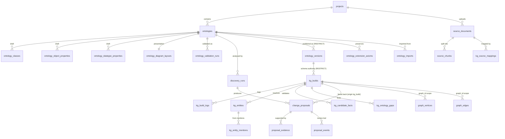
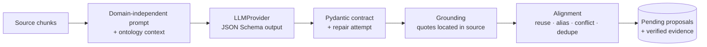
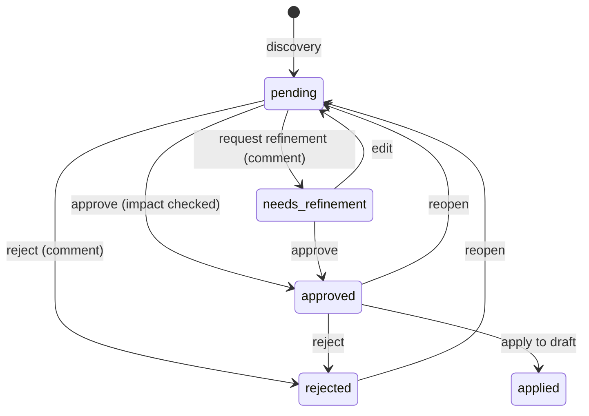
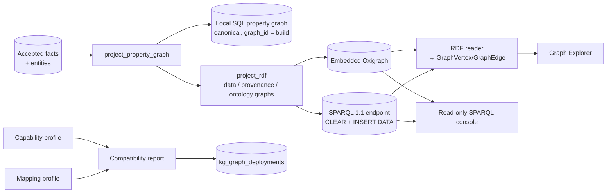
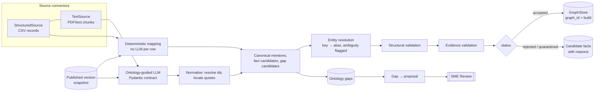

# Architecture

Ontology Lifecycle Studio supports **human-governed, AI-assisted ontology engineering and
knowledge-graph construction**.

> LLMs assist discovery. Domain experts govern meaning. Engineering systems enforce consistency.

This document describes the architecture as implemented through **Phase 3** (knowledge-graph
engineering, visualisation, evaluation and ontology feedback). Decisions and their rationale are in
[DECISIONS.md](./DECISIONS.md); the delivery plan is in [IMPLEMENTATION_PLAN.md](./IMPLEMENTATION_PLAN.md).

## 1. Principles

| Principle | How it is applied |
|---|---|
| The approved ontology is a long-lived asset | Ontologies evolve through draft revisions; published versions are immutable snapshots with write-once artifacts. |
| Humans govern meaning | AI output only ever becomes *pending proposals*. Nothing changes the draft until an SME approves and explicitly applies it; nothing ever changes a published version. |
| Engineering enforces consistency | Evidence grounding, deterministic alignment, validation impact on every proposal, a validation gate on publication, optimistic concurrency and an audit trail. |
| Do not trust the model blindly | Pydantic-validated structured output, quotes verified against the source, invented ids rejected, duplicate and conflicting suggestions re-classified. |
| Domain independence | No business classes in application logic or prompts. Supply Chain exists only as seed and sample *data*. |
| Real behaviour only | Every UI action calls a real API. Without a configured LLM, discovery and document extraction are disabled - nothing is simulated. |
| The published version is the schema authority | Knowledge-graph builds bind to one immutable published version; facts that do not fit it are rejected or become ontology gaps, never silently repaired. |
| Traceability | Every graph node and edge links to accepted facts, and every fact to its source record or located quote, ontology version and build. |

## 2. System context

```mermaid
flowchart LR
  user([Ontology engineer / SME]) --> ui[React SPA<br/>Vite · TanStack Query · React Flow]
  ui -- "/api (JSON, multipart)" --> api[FastAPI modular monolith]
  api --> db[(SQLite now<br/>PostgreSQL-ready)]
  api -- OpenAI-compatible --> llm[[LLM provider<br/>Ollama · OpenAI · Azure OpenAI · vLLM]]
  api --> artifacts[(Write-once artifact store<br/>JSON · Turtle)]
  api --> graph[(GraphStore<br/>SqlGraphStore now · Cosmos DB Gremlin later)]
```

## 3. Repository layout

```text
.
├── backend/
│   ├── app/
│   │   ├── core/                settings, error envelope, id/time helpers
│   │   ├── db/                  declarative base, UTC type, engine/session, migration runner
│   │   ├── modules/
│   │   │   ├── projects/        project management
│   │   │   ├── ontology/        canonical schema model, authoring, drafts
│   │   │   ├── validation/      structural rules + validation runs
│   │   │   ├── activity/        append-only audit trail
│   │   │   ├── llm/             LLMProvider protocol, OpenAI-compatible provider, status API
│   │   │   ├── sources/         DocumentParser protocol, text/PDF parsing, chunking, uploads
│   │   │   ├── discovery/       LLM contract, prompts, grounding, alignment, discovery runs
│   │   │   ├── governance/      change proposals, evidence, decisions, impact, apply
│   │   │   ├── registry/        snapshots, diff, RDF export, artifact repository, publishing
│   │   │   ├── kg/              connectors, mappings, LLM extraction, resolution, fact validation,
│   │   │   │                    orchestrator, evaluation, feedback, queries, API
│   │   │   ├── graph/           GraphStore protocol + SqlGraphStore adapter
│   │   │   └── seed/            Supply Chain demonstration data (+ sample source loader)
│   │   ├── main.py              app factory, router composition, lifespan
│   │   └── cli.py               `migrate` / `seed` / `seed-samples` commands
│   ├── migrations/              Alembic 0001 (Phase 1), 0002 (Phase 2 + immutability triggers), 0003 (Phase 3), 0004+ (Phase 4)
│   └── tests/                   pytest unit + API tests (LLM via an explicit test double)
├── frontend/
│   ├── src/features/ontology/   designer · discovery · review · validation · semantics (RDF/OWL) · registry · governance
│   ├── src/features/kg/         pipeline · explorer (Cytoscape) · facts · evaluation
│   └── e2e/                     Phase 1 journey, Phase 2 governance, Phase 3 KG and Phase 4 semantic journeys (playwright-core)
├── samples/                     discovery handbook; supply-chain/ CSVs + PDF for KG builds; party-ontology.ttl (RDF import)
└── docs/
```

## 4. Backend

### 4.1 Modules (modular monolith)

| # | Module | Package | Status |
|---|---|---|---|
| 1 | Project & data source management | `projects`, `sources`, `kg.connectors` | ✔ (documents and structured CSV sources, preview) |
| 2 | Ontology domain model & authoring | `ontology` | ✔ |
| 3 | Ontology discovery & alignment | `llm`, `discovery` | ✔ Phase 2 |
| 4 | SME review & governance | `governance` | ✔ Phase 2 (+ KG-origin proposals) |
| 5 | Ontology validation | `validation` | Structural rules ✔ (reused for impact and publication) |
| 6 | Registry & publishing | `registry` | ✔ Phase 2 (snapshots are the KG schema authority); Phase 4 `ols-semantic/2` packages |
| 6b | Standards semantics (RDF/OWL import & export, preserved axioms, reasoning) | `semantics` | ✔ Phase 4.1 |
| 6c | SHACL shapes (generation, authoring, PySHACL engine) and validation policies | `shacl`, `kg.policy`, `kg.rdf_candidates` | ✔ Phase 4.2 |
| 11 | Settings: LLM configurations, graph database connections, project defaults | `settings`, `graph.targets` | ✔ Phase 4 |
| 7 | KG extraction | `kg.mapping`, `kg.extraction`, `kg.resolution` | ✔ Phase 3 |
| 8 | Fact validation | `kg.validation` | ✔ Phase 3 (structural + evidence) |
| 9 | Graph persistence & query | `graph`, `kg.queries` | ✔ Phase 3 (`SqlGraphStore`) |
| 10 | KG evaluation & ontology feedback | `kg.evaluation`, `kg.feedback` | ✔ Phase 3 |
| - | Audit trail (cross-cutting) | `activity` | ✔ |

Each module is layered as router (HTTP only) → service (use cases, transactions) → repository /
pure functions → ORM models, with Pydantic contracts. Pure, framework-free functions carry the
critical logic so it can be unit-tested: `validate_schema`, `ground_quote`, `align_findings`,
`apply_change`, `assess_impact`, `diff_snapshots`, `snapshot_to_graph`, `transform_records`,
`resolve_entities`, `assess_*_structure`, `assess_*_evidence`, `compute_evaluation`.

### 4.2 Canonical ontology model

`modules/ontology/domain.py` defines `ClassDefinition`, `ObjectPropertyDefinition`,
`DatatypePropertyDefinition` and `OntologySchema`. Elements have a stable `id` (used by all
references, proposals and diffs), an editable `local_name` and, since Phase 4, a persisted `iri`
(minted as `namespace + local_name`, locked once published - ADR-037). The model is schema-only and
independent of SQLAlchemy, React Flow, LLM output and graph databases.

Phase 4 makes the model the authoritative representation of the **OLS Semantic Profile**
(ADR-035): each element carries a `semantics` object (`ClassSemantics` - equivalent and disjoint
classes, restrictions; `ObjectPropertySemantics` - super-properties, inverse, characteristics;
`DatatypePropertySemantics` - super-properties, explicit `functional`, whether the XSD range is
declared; all with deprecation, annotation language and the description predicate). The schema
carries the ontology header (`ontology_iri`, `prefixes`, `imports`, `require_domain_range`) and the
list of preserved `extension_axioms`. `required` / `multi_valued` are data constraints (ADR-036).
Supported XSD datatypes: string, integer, decimal, boolean, date, dateTime, anyURI, float, double,
int, long, time, gYear.

### 4.3 Persistence model



| Table | Purpose |
|---|---|
| `source_documents`, `source_chunks` | Extracted text (unique per project by SHA-256) and offset/page-tracked chunks. |
| `discovery_runs` | Baseline (draft revision or published version), documents, model, prompt version, progress, usage, discarded findings, status. |
| `change_proposals` | Type (ADD/REUSE/ALIAS/MODIFY/CONFLICT), status, target element, new element or field-level `{before, after}` changes, alignment notes, dependencies, the verbatim validated LLM finding, apply results. |
| `proposal_evidence` | Verified quote, context, document name, page and offsets - stored denormalised so evidence survives document deletion. |
| `proposal_events` | Append-only review timeline: created, commented, edited, approved, rejected, refinement requested, reopened, applied, apply failed (with actor and comment). |
| `ontology_versions` | Immutable published snapshot, content hash, version, validation summary, change summary, artifact checksums, publisher and notes. Snapshot format `/1` (Phase 1-3, legacy) or `/2` (Phase 4: IRIs, semantics, header, preserved axioms). |
| `ontology_classes` / `ontology_object_properties` / `ontology_datatype_properties` | Draft elements; Phase 4 adds `iri` and `semantics` (JSON, only non-default values stored). `ontologies` gains `ontology_iri`, `prefixes`, `imports`, `require_domain_range`. |
| `ontology_extension_axioms` | Preserved triples outside the profile: scope (`ontology`/`shapes`), kind, summary, N-Triples, anchor element ids, originating import. Never touched by draft saves. |
| `ontology_imports` | RDF import records: file name, format, SHA-256, actor and the full import report. |
| `ontology_shapes` | Authored SHACL node shapes of the draft (target class, severity, message, property constraints as JSON). Generated shapes are derived; imported SHACL lives in `ontology_extension_axioms` (scope `shapes`). |
| `kg_candidate_facts.lanes` | Phase 4 per-fact lanes: policy (id, relaxed application checks), SHACL results with outcomes, entailment checks and inferred types. NULL for builds evaluated before Phase 4. |
| `projects.data_namespace` | Optional base for instance IRIs (`{data_namespace}e/{vertex_id}`); default `{ontology IRI}/data/`, frozen per build. |
| `llm_configurations` | Registered OpenAI-compatible LLM endpoints (base URL, model, structured-output mode, temperature, timeout, token limit) with the **name** of the environment variable that holds the API key; last connection test. |
| `graph_connections` | Registered graph databases (kind, non-secret configuration, environment variable for the password); last connection test. |
| `projects.default_llm_config_id` / `default_graph_connection_id` | Project defaults; NULL = environment default LLM / local SQL graph. |
| `kg_source_mappings` | Saved, reusable source-to-ontology mapping (generic spec of entity, attribute and relationship mappings by element id) per structured source. |
| `kg_builds` | Build configuration (published version, sources, mappings, settings), frozen config snapshot at start (source hashes, mapping specs, LLM provider/model/prompt version), nine stage records, statistics, evaluation, validated LLM outputs, status. |
| `kg_build_logs` | Append-only execution log per build and stage. |
| `kg_entities`, `kg_entity_mentions` | Resolved entities with the resolution decision (method, ambiguity candidates, notes) and every source mention (denormalised provenance). |
| `kg_candidate_facts` | Type, relationship and attribute facts with independent structural, evidence and resolution check results, status, reasons, sources and the graph element they produced. |
| `kg_ontology_gaps` | Unknown classes, relationships, attributes and unmapped fields with suggestion, evidence, occurrences and linked proposals. |
| `graph_vertices`, `graph_edges` | `SqlGraphStore` data keyed by `(graph_id, id)`: Gremlin-shaped labels, properties, fact ids and source ids. |

### 4.4 AI discovery pipeline



1. **Run** (`POST /ontologies/{id}/discovery-runs`, 202): validated, queued and executed by a
   background worker; the UI polls progress. One active run per ontology; runs interrupted by a
   restart are marked failed at startup.
2. **Prompting**: chunks are batched (`OLS_DISCOVERY_BATCH_CHARS`), labelled `C1..Cn`, and sent with
   a compact rendering of the baseline ontology (ids, labels, aliases, hierarchy, signatures).
   The prompt contains no business concepts and tells the model to treat the source as data.
3. **Structured output**: `LLMDiscoveryResponse` (Pydantic) is sent as JSON Schema
   (`$ref`s inlined for grammar-based engines) and every reply is validated; one repair prompt is
   sent on failure. A malformed batch is recorded and skipped; a transport error fails the run.
4. **Grounding**: each quote must be located in a chunk (case/whitespace/typographic-quote
   insensitive, strict fuzzy fallback for long quotes). Verified quotes are replaced by the exact
   source span with offsets and context. Findings without verified evidence are discarded and
   listed on the run with a reason.
5. **Alignment** (deterministic): labels, local names and aliases are normalised (case, camelCase,
   plurals) and matched exactly or by similarity.
   * ADD of an existing concept → REUSE, or ALIAS when the source term is a new synonym.
   * ADD of a relationship whose name exists with a different domain/range → CONFLICT.
   * Relationship with a literal range (`string`, `xsd:date`, …) → attribute of that datatype.
   * REUSE/ALIAS of an unknown concept → ADD; MODIFY/CONFLICT of an unknown element → discarded.
   * ALIAS colliding with another element's name → CONFLICT; no-op MODIFY → REUSE.
   * Near matches are flagged as possible duplicates; duplicate findings are merged.
   * Domain/range/parent references resolve to existing classes or to classes added in the same
     run (recorded as proposal dependencies); unresolved references are flagged.
   Every adjustment is recorded as an alignment note, and the original model action is kept.

### 4.5 SME review and governance



* **Impact** (`assess_impact`): applies the proposal - after its unapplied dependencies - to a
  copy of the current draft and runs `validate_schema` before and after; the delta (introduced and
  resolved issues) is shown with every proposal. Approval is refused when the proposal is not
  applicable or would introduce error-severity issues.
* **Edit**: SMEs can change the type, target, new element or proposed values; `before` values are
  rebased on the current draft. The original model output is never modified.
* **Apply** (`POST /ontologies/{id}/proposals/apply`): approved proposals are applied in
  dependency order with `apply_change` (references must exist, local names unique, hierarchy
  acyclic, scalar fields checked for drift since the proposal was created, list fields merged).
  Failures are isolated per proposal; successful changes are persisted in one transaction through
  `OntologyService.replace_schema`, which increments the draft revision and records activity.
  Published versions are never touched.

### 4.6 Registry and publication

* **Snapshot**: canonical JSON (elements sorted by id) with a SHA-256 content hash.
* **Publish** (`POST /ontologies/{id}/versions`): runs and persists a fresh validation and
  refuses on errors; refuses when the draft equals the latest version; requires a semantic version
  greater than the latest (suggested from the diff: removals and IRI/signature changes → major,
  additions → minor, documentation → patch); optional optimistic check of the reviewed draft
  revision; writes JSON and Turtle artifacts, then commits the version (artifacts are removed if
  the commit fails).
* **Immutability** in four layers: no update/delete endpoints; SQLAlchemy `before_update` /
  `before_delete` guards; database triggers (SQLite `RAISE(ABORT)`, PostgreSQL trigger function)
  and a `RESTRICT` foreign key from versions to ontologies; artifact files created exclusively,
  marked read-only and verified against their checksum on every export.
* **Compare** (`GET /ontologies/{id}/compare?base=&target=`): field-level diff between any two
  versions or a version and the draft.
* **RDF (legacy, Phase 1-3)**: `registry/rdf.py` is frozen for `/1` snapshots - `owl:Ontology`
  with `owl:versionInfo`/`owl:versionIRI`, classes, object and datatype properties,
  `rdfs:subClassOf`, domain/range, XSD ranges, `skos:definition`, `skos:altLabel`,
  `dcterms:identifier`, `owl:FunctionalProperty` for single-valued attributes and
  `owl:minCardinality 1` for required attributes.
* **RDF (Phase 4, `semantics/owl.py`)**: persisted IRIs, explicit ontology IRI, custom prefixes,
  `owl:imports`, language-tagged annotations, `skos:definition` or `rdfs:comment`, sub-properties,
  inverse, characteristics, equivalence, disjointness, restrictions, `owl:deprecated`, and the
  preserved axioms merged back verbatim. No OWL axioms are derived from `required`/`multi_valued`.
* **Packages** (ADR-038): `/2` publications store snapshot JSON, Turtle, RDF/XML, JSON-LD,
  N-Triples and a manifest (`ols-semantic/2`). Legacy versions keep their stored bytes; other
  syntaxes are derived from the stored Turtle on export (`X-Artifact-Derived: true`).
* **Diff (Phase 4)**: IRIs are normalised (legacy snapshots derive them); an IRI change is
  breaking, a local-name change with a locked IRI is a patch, semantics changes are minor,
  preserved axioms added → minor / removed → major, and a `/1` → `/2` publication carries a
  *semantic profile change* note.

### 4.6b Standards semantics (Phase 4)

| Component | Responsibility |
|---|---|
| `semantics/graphs.py` | RDF formats (Turtle, RDF/XML, JSON-LD, N-Triples), parsing, blank-node components, canonical N-Triples. |
| `semantics/owl.py` | `/2` OWL serialiser (above). |
| `semantics/rdf_import.py` | Conservative interpretation of profile patterns; reconciliation by blank-node component; preserved axioms (with kind, summary and anchors; SHACL → `shapes` scope); verified no-loss guarantee; import report. |
| `semantics/reasoning.py` | `owlrl` OWL 2 RL entailment preview and inconsistency detection on a copy (ADR-039). |
| `validation/rules.py` (extended) | `IRI_INVALID`, `DUPLICATE_IRI`, `ONTOLOGY_IRI_INVALID`, `IMPORT_IRI_INVALID`, `PREFIX_*`, `SEMANTIC_REFERENCE_INVALID`, `DISJOINT_WITH_RELATED_CLASS`, `CHARACTERISTICS_CONFLICT`, `EXTENSION_AXIOM_ORPHANED`; missing domain/range is an error only when `require_domain_range` is on. |

Validation layers stay separate: **structural** rules (above), **OWL reasoning** (informational
preview), **SHACL** (below) and **evidence** validation of KG facts (Phase 3).

### 4.6c SHACL and validation policies (Phase 4.2)

| Component | Responsibility |
|---|---|
| `shacl/shapes.py` | Deterministic shapes graph of a snapshot: **generated** constraint shapes (`required` → `sh:minCount 1`, single value → `sh:maxCount 1`, attribute datatype → `sh:datatype`, relationship range → `sh:class`), generated **signature** shapes (`sh:targetSubjectsOf`/`sh:targetObjectsOf` + `sh:class`, tagged `ols:shapeRole "signature"`), **authored** node shapes and **preserved** imported SHACL; a shape index maps shape IRIs back to elements. |
| `shacl/engine.py` | PySHACL with `inference="none"` and the ontology graph mixed in (so `sh:class` respects `rdfs:subClassOf`); SHACL-SHACL meta-validation; works on copies because PySHACL adds vocabulary triples to the graphs it receives. |
| `shacl/service.py` | Authored-shape CRUD (validated, audited, increments the draft revision), draft shapes export, sample-data validation, SHACL import as preserved shapes (meta-validated, de-duplicated). |
| `kg/policy.py` | Immutable, versioned validation policies (`application-strict/1` default, `shacl-signature/1`, `infer-and-flag/1`); each build records the full policy configuration. |
| `kg/rdf_candidates.py` | RDF view of structurally projectable candidates (asserted types only, typed literals) under `{data_namespace}e/`; SHACL lane; OWL 2 RL entailment lane for open-world policies; results mapped to facts by (focus, path, value), to entities for node-level results and via the index for signature shapes. |

Publication materialises the shapes graph into the version package (`shapes.ttl`); later generator
changes therefore never alter history. Builds on legacy versions derive shapes from the immutable
snapshot at build time and label them so. New builds run **ten stages** (SHACL validation after
structural validation); builds created earlier keep nine stages and are never re-judged.

| Policy | Domain/range | SHACL | Entailment |
|---|---|---|---|
| `application-strict/1` | Application check rejects (reversal diagnosed) - Phase 3 behaviour | Violation → reject; Warning → warn; Info → info; generated `minCount` → warn; generated `maxCount` → info (conflicts stay quarantined by the application) | not run |
| `shacl-signature/1` | Enforced by signature shapes; application check reported as information | as above; signature violations → reject | not run |
| `infer-and-flag/1` | Not rejected; implications computed | as above | OWL 2 RL: incompatible implied types or inconsistencies → quarantine; refinements accepted and recorded |

Under `application-strict/1` the outcome of every Phase 3 fact is unchanged (verified on the sample
data: 51 accepted, 4 rejected, 2 quarantined); SHACL adds warnings for missing required values.

### 4.6d Settings (Phase 4)

* **Built-ins** are virtual: the *Environment default* LLM (`OLS_LLM_*`, read-only), the *Local SQL
  property graph* and the *Embedded Oxigraph* RDF store (`OLS_OXIGRAPH_DIR`).
* **Registered configurations** are shared by all projects. Secrets are referenced by environment
  variable name only; the API reports whether the variable is set but never its value.
* **Connection tests are real and read-only**: an LLM test calls the endpoint's `/models` API and
  checks that the model is listed (no prompt is sent); graph tests count rows in the application
  database, open the embedded store, or send `ASK` to a SPARQL endpoint. Failures are reported as
  they occur.
* **Resolution**: discovery runs and KG builds use their own selection, else the project default,
  else the built-in. Builds freeze the effective LLM configuration, graph target and data namespace
  in their configuration snapshot.
* **Graph kinds** (`graph/targets`): `local-sql`, `oxigraph` (built-in), `sparql-http`
  (registrable). Neo4j and Azure Cosmos DB (Gremlin) are listed as *not available* with the reason
  (no reachable server to implement and verify an adapter against); they cannot be registered.

### 4.6e Multi-graph projections and deployments (Phase 4.4/4.5)



* **Projections** (`graph/projection.py`) are pure functions of (accepted facts, published
  version, data namespace). `project_property_graph` is the Phase 3 graph-persistence logic, moved
  unchanged. `project_rdf` produces three named graphs per build:
  `{data_namespace}build/{build_id}` (`rdf:type` with the class IRI, `rdfs:label`,
  `dcterms:identifier`, `skos:altLabel`, typed literals, relationships with the property IRI),
  `.../provenance` (`ols:fact`/`ols:source` per element; one `ols:Relationship` resource
  `{data_namespace}r/{edge_id}` per edge - works on any SPARQL 1.1 store, no RDF-star) and
  `.../ontology` (the published OWL).
* **Capability profiles** (`graph/capabilities.py`, versioned, e.g. `oxigraph/1`) state what a
  target represents natively. Profiles of targets with an adapter are *verified* by the adapter
  and its integration tests; Neo4j and Cosmos DB profiles are documented assumptions used only for
  compatibility previews. **Mapping profiles** (`rdf-default/1`, `rdf-data-only/1`,
  `lpg-default/1`) are immutable and code-defined.
* **Compatibility report** (`graph/compatibility.py`): one row per feature (class membership,
  identity, typed values, lexical forms, multi-valued attributes, provenance, build isolation,
  hierarchy, restrictions, disjointness/equivalence, property characteristics, language-tagged
  annotations, preserved axioms, SHACL shapes) with outcome *native / transformed / partial /
  not stored / semantic loss* and the number of affected elements. A report with semantic loss
  must be acknowledged; the acknowledging user is recorded on the deployment.
* **Adapters** (`graph/targets/adapters.py`). *Local SQL*: idempotent upserts. *Embedded
  Oxigraph*: `remove_graph` + N-Triples load per named graph. *SPARQL HTTP*: `CLEAR SILENT GRAPH`
  and `INSERT DATA` in chunks of 2,000 triples over the update endpoint (graphs with blank nodes
  are sent in one request). Every deployment is **verified** by counting the triples (or
  vertices/edges) the target holds afterwards; a mismatch fails the deployment.
* **Builds** always write the canonical local SQL graph and record it as a deployment; when the
  build's graph target is another store the build also deploys there. A failing target is recorded
  (status `failed`, error, build log warning) and never fails the build. Completed builds can be
  deployed again from the *Deployments* tab; a successful re-deployment replaces the build's graphs
  and supersedes the earlier record.
* **Reading back** (`graph/rdf_reader.py`, `graph/memory_store.py`): the explorer accepts
  `deployment_id`; the build's data and provenance graphs are fetched from the target (CONSTRUCT
  or dump), rebuilt into `GraphVertex`/`GraphEdge` with identical ids and served with the exact
  read semantics of `SqlGraphStore` (cached for 15 s). Fact details always come from the build's
  fact store. Triples that cannot be attributed are counted as read warnings, never invented.
* **Query console** (`graph/sparql.py`): queries are parsed by rdflib first - only SELECT, ASK,
  CONSTRUCT and DESCRIBE are accepted (every update form fails the query grammar) and `SERVICE` is
  refused. The default graph is the build's data graph; its provenance and ontology graphs are the
  named graphs. Results are capped at 1,000 rows (lazily on Oxigraph).
* **Migration 0007** adds `kg_graph_deployments` and records, for every build completed before the
  upgrade, a factual `legacy` deployment of its local SQL graph (counts read from the graph tables).

### 4.7 Knowledge-graph engineering (Phase 3)



**Build lifecycle.** A build is configured (published version, sources, one saved mapping per
structured source, extraction settings), then started. Starting validates readiness (sources
exist, mappings are compatible with the selected version, LLM configured when documents are
included, one active build per project) and freezes a configuration snapshot: source hashes,
mapping specs, ontology version and content hash, LLM provider/model/prompt version. The
orchestrator (`kg/orchestrator.py`) runs as a FastAPI background task - a deterministic Python
workflow, no queue or agent framework - and persists each of the nine stages (status, timing,
counts, summary) and every log line. Interrupted builds are failed at startup. Configuration is
editable only before start; executed builds are kept (not deletable) and rebuilding creates a new
build linked to its parent.

| Stage | Work |
|---|---|
| 1 Source loading | Load the version snapshot (`OntologyView`) and open connectors; verify source hashes. |
| 2 Content parsing | Count records, re-check mappings against the columns and version, prepare chunk batches. |
| 3 Entity extraction | Deterministic `transform_records` for structured sources; one LLM request per batch for documents (entities normalised now). |
| 4 Relationship extraction | Normalise LLM relationships, attributes and unknown concepts; predicates resolved against the version. |
| 5 Entity resolution | `resolve_entities`; resolved entities and mentions persisted. |
| 6 Structural validation | `assess_*_structure` for every entity type fact, relationship and attribute. |
| 7 Evidence validation | `assess_*_evidence`; status derived; single-value conflicts quarantined; facts persisted. |
| 8 Graph persistence | Accepted facts → `GraphVertex`/`GraphEdge` upserts under the build's graph scope (since Phase 4.4: through `project_property_graph`, recorded as the canonical deployment, then deployed to the build's selected graph target - see 4.6e). |
| 9 Evaluation | Gaps persisted; metrics computed and stored on the build. |

**Source connectors** (`kg/connectors.py`). The pipeline depends on two protocols:
`StructuredSource` (columns + records) and `TextSource` (page-aware chunks). Today both are backed
by Phase 2 source documents (CSV text parsed with the `csv` module; PDF chunks never span pages).
A Snowflake table/query connector implements `StructuredSource` without changing mappings or the
pipeline.

**Mappings** (`kg/mapping.py`). A generic spec of entity mappings (fixed class or class named in
a column, identifier/label/alias columns, key namespace, reference-only flag, attribute → datatype
property) and relationship mappings (fixed predicate or predicate named in a column, between two
entity mappings of the same record). Validation against a version reports errors (unknown
columns/elements) and warnings (domain mismatch, reversed direction - such facts will be rejected).
A deterministic, column-name based suggestion pre-fills new mappings for SME review.

**LLM extraction** (`kg/extraction.py`, prompt `kg-extraction/2026-10-1`). The prompt renders
the published snapshot (class ids, relationship ids with domain → range, attribute ids) and the
chunk batch; the model returns `LLMExtractionResponse` (entities, relationships, attributes,
unknown concepts, each with chunk id and verbatim quote). Normalisation resolves references only
against the snapshot (unknown ones become gap candidates and invalid facts), locates every quote in
the real text (`ground_quote`) and keeps the validated output on the build for audit. Raw model
output is never written to the graph.

**Entity resolution** (`kg/resolution.py`). (1) Business key: same class, key namespace and
normalised identifier - text mentions may also match one identified entity of a compatible sub- or
superclass. (2) Mentions without an identifier merge only with exactly one identified entity of a
compatible class whose label or configured alias matches. (3) Several candidates → a separate,
*ambiguous* entity whose facts are quarantined. Similarity never merges. Vertex ids are stable
hashes of class + key, so the same entity has the same id in every build.

**Fact validation** (`kg/validation.py`) - two independent categories plus resolution:

| Category | Checks |
|---|---|
| Structural | Class / predicate / attribute defined in the version; right property kind; subject/object refer to extracted, identified entities of defined classes; domain and range with subclass inheritance (a reversed relationship is reported as such and never repaired); literal parses as the declared XSD datatype. |
| Evidence | Traceable source and location; structured facts are stated by their record; text facts need a quote located in the source that mentions both entities (or contains the value); both endpoints must be established by a source record or located text. |
| Resolution | Ambiguous entity; conflicting value of a single-valued attribute. |

Status: structural failure → **REJECTED**; resolution failure or weak / unlocated evidence →
**QUARANTINED**; no evidence → **REJECTED**; otherwise **ACCEPTED**. Every check result and reason
is persisted. Entity type facts ("X is a Supplier") are validated too; only accepted entities become
nodes.

**Graph storage** (`graph/`). `GraphStore` protocol: idempotent `upsert_vertices` /
`upsert_edges`, `get_vertex` / `get_edge`, `fetch_graph`, `search_vertices`, `edges_of`,
`neighborhood`, `provenance`, `counts`. `SqlGraphStore` is the durable local adapter (no Neo4j or
Cosmos connection is configured). The data model is Gremlin-shaped: vertex label = class local
name, edge label = property local name, properties, and a `graph_id` scope that maps to a Cosmos
partition key. Edge ids hash (subject, predicate, object), so duplicate facts from several sources
merge into one edge whose provenance lists all of them. Each build writes only its own scope; a
rebuild never touches an earlier graph.

**Evaluation** (`kg/evaluation.py`). Indicators with explicit numerator, denominator and
definition: sources/records/chunks processed, LLM batches, mentions, entities, relationship and
attribute candidates, accepted/rejected/quarantined, acceptance rates, class/relationship/attribute
coverage of the version, missing class/relationship/attribute mappings and unmapped fields, facts
lacking adequate provenance, graph elements without provenance, entities missing required
attributes, and resolution outcomes. The evaluation states that it does not measure precision or
recall.

**Ontology feedback** (`kg/feedback.py`). Selected gaps (plus the unknown classes that selected
relationship/attribute gaps depend on) become `LLMFinding`-shaped ADD findings with the source
records/quotes as evidence, are aligned against the ontology's *current draft* with the Phase 2
`align_findings` (duplicates become REUSE/ALIAS) and stored with `persist_drafts` as pending
proposals (`origin = kg_build`, `kg_build_id`). They enter the unchanged SME review → apply →
publish flow; once a new version is published it is selectable for the next build.

### 4.8 API

All endpoints are under `/api` (OpenAPI at `http://127.0.0.1:8000/docs`); errors use
`{"error": {"code", "message", "details"}}`.

| Area | Endpoints |
|---|---|
| System | `GET /health`, `GET /llm/status?check=` |
| Projects | `GET/POST /projects`, `GET/PATCH /projects/{id}`, `GET /projects/{id}/activity` |
| Ontologies & draft | `GET/POST /projects/{id}/ontologies`, `GET/PATCH/DELETE /ontologies/{id}`, `GET/PUT /ontologies/{id}/draft` |
| Elements | CRUD under `/ontologies/{id}/classes`, `/object-properties`, `/datatype-properties` |
| Validation | `POST/GET /ontologies/{id}/validations`, `GET /ontologies/{id}/validations/latest` |
| Sources | `GET/POST(multipart) /projects/{id}/sources`, `GET/DELETE /sources/{id}`, `GET /sources/{id}/preview` |
| Discovery | `POST/GET /ontologies/{id}/discovery-runs`, `GET /discovery-runs/{id}` |
| Governance | `GET /ontologies/{id}/proposals?status=&type=&run_id=&origin=&kg_build_id=`, `GET /ontologies/{id}/proposals/stats`, `POST /ontologies/{id}/proposals/apply`, `GET/PATCH /proposals/{id}`, `POST /proposals/{id}/decision`, `POST /proposals/{id}/comments` |
| Registry | `GET /ontologies/{id}/publish-preview`, `GET/POST /ontologies/{id}/versions`, `GET /ontologies/{id}/versions/{vid}`, `GET /ontologies/{id}/versions/{vid}/export?format=turtle\|rdfxml\|jsonld\|ntriples\|json\|manifest`, `GET /ontologies/{id}/compare` |
| Semantics (Phase 4) | `GET /ontologies/{id}/rdf?format=&download=`, `POST(multipart) /projects/{id}/ontologies/import`, `GET /ontologies/{id}/imports`, `GET /ontologies/{id}/axioms`, `DELETE /ontologies/{id}/axioms/{aid}?deleted_by=`, `GET /ontologies/{id}/entailments` |
| Settings (Phase 4) | `GET/POST /settings/llm-configurations`, `GET/PUT/DELETE /settings/llm-configurations/{id}`, `POST /settings/llm-configurations/{id}/test`, `GET /settings/graph-kinds`, `GET/POST /settings/graph-connections`, `GET/PUT/DELETE /settings/graph-connections/{id}`, `POST /settings/graph-connections/{id}/test`, `GET/PUT /projects/{id}/defaults`; `GET /llm/status?project_id=&config_id=` |
| SHACL (Phase 4) | `GET/POST /ontologies/{id}/shapes`, `PUT/DELETE /ontologies/{id}/shapes/{sid}?actor=`, `GET /ontologies/{id}/shapes/rdf`, `POST /ontologies/{id}/shapes/validate`, `POST(multipart) /ontologies/{id}/shapes/import`, `GET /kg/validation-policies`; version export `format=shapes` |
| KG configuration | `GET /projects/{id}/kg/ontology-versions` (published only), `GET/POST /projects/{id}/kg/mappings`, `POST /projects/{id}/kg/mappings/validate`, `GET /sources/{id}/mapping-suggestion?ontology_version_id=`, `GET/PUT/DELETE /kg/mappings/{id}` |
| KG builds | `GET/POST /projects/{id}/kg/builds`, `GET/PATCH/DELETE /kg/builds/{id}`, `POST /kg/builds/{id}/start`, `POST /kg/builds/{id}/rebuild`, `GET /kg/builds/{id}/logs?after=`, `GET /kg/compare?base=&target=` |
| Facts & entities | `GET /kg/builds/{id}/facts?status=&kind=&source_id=&predicate_id=&q=`, `GET /kg/facts/{id}`, `GET /kg/builds/{id}/entities?q=&method=`, `GET /kg/entities/{id}` |
| Graph | `GET /kg/builds/{id}/graph?class_id=&predicate_id=&source_id=&deployment_id=`, `GET /kg/builds/{id}/graph/search?q=&deployment_id=`, `GET /kg/builds/{id}/graph/nodes/{vid}/neighborhood?deployment_id=`, `GET /kg/builds/{id}/graph/elements/{eid}?deployment_id=` (with provenance) |
| Graph deployments (Phase 4) | `GET /kg/graph-capabilities`, `GET /kg/builds/{id}/compatibility?target_id=\|kind=&mapping_profile=`, `GET/POST /kg/builds/{id}/deployments`, `GET /kg/deployments/{id}`, `POST /kg/deployments/{id}/query` (read-only SPARQL) |
| Evaluation & feedback | `GET /kg/builds/{id}/evaluation`, `GET /kg/builds/{id}/gaps`, `POST /kg/builds/{id}/gaps/proposals` |

### 4.9 Runtime

* `create_app(settings)` builds the engine, session factory, LLM provider (or `None`), artifact
  repository and graph-store factory per instance; tests replace the provider with a scripted
  test double.
* Startup applies migrations (`OLS_AUTO_MIGRATE`), fails interrupted discovery runs and KG builds,
  and seeds the demo project into an empty database.
* Configuration is environment-driven (`.env.example`); the LLM API key is a secret value that is
  never logged or returned by the API.

## 5. Frontend

Navigation has four sections: Project Workspace, Ontology Studio, Knowledge Graph Studio and - since
Phase 4 - **Settings** (project defaults, LLM models and graph databases: register, edit, test and
delete; kinds without an adapter are explained). Registered configurations are selectable when a
project is created, when a discovery run is started and when a KG build is configured.
Phase 2 functionality lives in **Ontology Studio** tabs:

| Tab | Capabilities |
|---|---|
| Ontology Designer | Visual editing of the working copy (Phase 1). |
| AI Discovery | Provider status, source upload (drag & drop), run configuration (baseline draft or published version, SME focus), live run progress, results by type, discarded findings with reasons. |
| SME Review | Queue with status/type/run filters and search; detail with validation impact, current vs proposed values, alignment notes (including where alignment overrode the model), rationale, verified evidence highlighted in context, editing, decisions with mandatory comments for reject/refine, review timeline, comments, and "Apply approved to draft". |
| Validation | Structural validation of the saved draft (Phase 1). |
| SHACL Shapes (Phase 4) | Well-formedness (SHACL-SHACL), authored shapes with a form editor (target class, severity, message, per-property min/max count, datatype, class, pattern, lengths, value range, allowed values), generated constraint and signature shapes (read-only), imported SHACL (preserved), sample-data validation, `shapes.ttl` download. |
| RDF / OWL (Phase 4) | OWL export preview of the saved draft in four syntaxes with downloads; RDF import into a new ontology with the import report (modelled, preserved, superseded, added triples, warnings) and import history; preserved axioms with kind, anchors, orphan status, N-Triples and audited removal; OWL 2 RL reasoning preview. |
| Registry | Publication preview (validation gate, changes since the last version, breaking changes, semantic-profile notes, preserved-axiom changes, suggested version), publish with release notes, version history with package format and checksum-verified downloads (legacy versions offer derived RDF syntaxes), version comparison. |

The Studio header offers an ontology switcher when a project has several ontologies (for example
after an RDF import). The ontology inspector edits the semantic header (ontology IRI, imports,
prefixes, domain/range policy); element inspectors show the persisted IRI.

The reviewer identifies themselves once (stored locally); the name is recorded on decisions,
comments, applications and publications. Applying and publishing are blocked while the designer
has unsaved changes; after applying, the draft reloads into the designer. The header shows the
latest published version, and the workspace summarises pending reviews, versions, data sources
(with preview) and the latest KG build with links into the studios.

All Phase 3 functionality lives in **Knowledge Graph Studio** (build selector in the header,
`?build=` and `?tab=` in the URL):

| Tab | Capabilities |
|---|---|
| Pipeline | Configuration panel (published version with its classes/relationships, source selection and upload, preview, per-source mapping editor with preview, suggestion and live validation, validation policy, extraction settings, configured LLM, readiness messages, save/start), execution status (nine stages with status, timing and summaries, real counts, errors, polled log), rebuild with another published version, build history and build comparison. |
| Graph Explorer | Cytoscape.js canvas of the persisted graph (class colours, directed labelled edges, pan/zoom, layout, fit), entity search, class / relationship / source filters, table fallback, and a right-hand drawer for nodes (class, identifier, attributes, relationships) and relationships (subject → predicate → object) with traceability (build, ontology version) and every supporting fact's validation checks and source evidence (original record or page text with the quote highlighted). *Read from* (Phase 4.4) switches between the canonical graph and any verified deployment, read back from its graph database (`?deployment=`). |
| Fact Validation | All candidate facts with status filters (accepted / rejected / quarantined), kind, source and text filters, evidence status, SHACL status and first reason; drawer with ontology property, structural checks, the SHACL lane (results with severity, policy outcome and shape), checks relaxed by the policy, the entailment lane, evidence / resolution checks and source excerpts. Builds evaluated before Phase 4 show "not run". |
| Evaluation & Feedback | Metric cards with definitions and numerator/denominator, failure-reason breakdown, ontology gaps with evidence and proposal status, "Create change proposals" into SME Review. |
| Deployments (Phase 4.4) | Deploy a completed build to a registered graph target with a mapping profile; live compatibility report (outcome per feature, affected counts, profile verification); explicit semantic-loss acknowledgement; compatibility preview for kinds without adapter; deployment history with expected and verified counts, errors and supersession; read-only SPARQL console with examples (SELECT/ASK/CONSTRUCT/DESCRIBE). |

## 6. Extension points

| Interface | Implementations | Notes |
|---|---|---|
| `LLMProvider` | `OpenAICompatibleProvider` (tests: scripted double) | Structured output + repair; swap via configuration. |
| `DocumentParser` | `PlainTextParser`, `PdfParser` | Add OCR/Office parsers without touching callers. |
| `OntologyArtifactRepository` | `FilesystemArtifactRepository` | Blob storage (e.g. Azure Blob with immutability policies) later. |
| `StructuredSource` / `TextSource` | `CsvDocumentSource`, `DocumentTextSource` | A Snowflake connector implements `StructuredSource` (columns + streamed records). |
| `GraphStore` | `SqlGraphStore` (canonical), `MemoryGraphStore` (read model over a deployment read back from RDF) | Azure Cosmos DB Gremlin adapter: vertex/edge labels and properties map 1:1, `graph_id` becomes the partition key, upserts use `fold().coalesce(unfold(), addV())`. Not implemented or claimed yet. |
| Deployment adapters (Phase 4.4) | `LocalSqlAdapter`, `OxigraphAdapter`, `SparqlHttpAdapter` | A new target kind adds a capability profile, a catalogue entry (`graph/targets`) and an adapter with deploy + verify + read-back; Neo4j and Cosmos DB need a reachable server to be built and verified against. |
