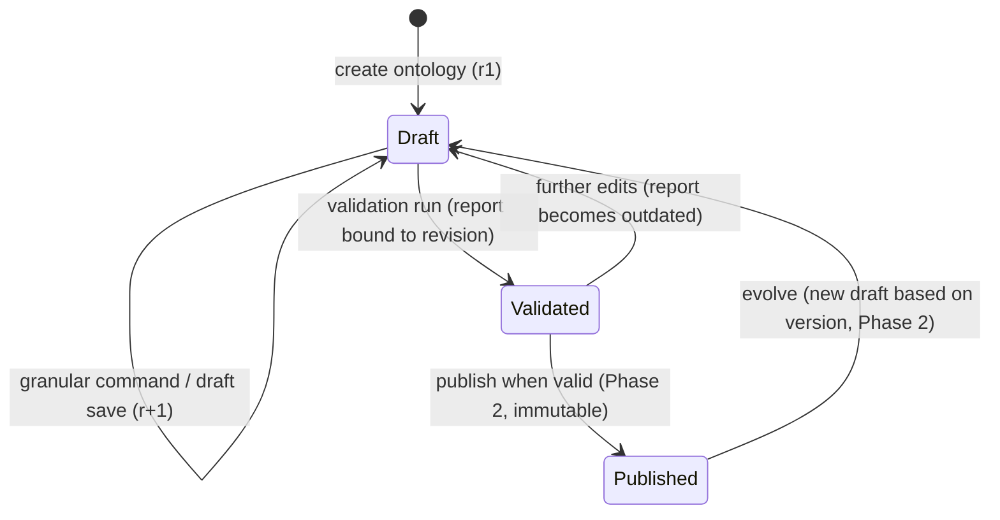

# Architecture

Ontology Lifecycle Studio supports **human-governed, AI-assisted ontology engineering and
knowledge-graph construction**.

> LLMs assist discovery. Domain experts govern meaning. Engineering systems enforce consistency.

This document describes the architecture as implemented in **Phase 1** and the extension points
reserved for Phases 2 and 3. Decisions and their rationale are recorded in
[DECISIONS.md](./DECISIONS.md); the delivery plan is in [IMPLEMENTATION_PLAN.md](./IMPLEMENTATION_PLAN.md).

## 1. Principles

| Principle | How it is applied |
|---|---|
| The approved ontology is a long-lived asset | Ontologies belong to projects and evolve through draft revisions; published versions (Phase 2) are immutable snapshots. |
| Humans govern meaning | No AI output changes an ontology directly. AI proposals (Phase 2) enter an SME review queue. |
| Engineering enforces consistency | Write-time invariants, optimistic concurrency, structural validation as a publication gate, audit trail. |
| Domain independence | No business classes in application logic. Supply Chain exists only as seed *data*. |
| Schema ≠ facts | The canonical ontology model describes schema (TBox). KG facts (ABox) have a separate model (Phase 3). |
| Real behaviour only | Every UI action calls a real API. Not-yet-built capabilities are labelled as planned, never simulated. |

## 2. System context

```mermaid
flowchart LR
  user([Ontology engineer / SME]) --> ui[React SPA<br/>Vite · TanStack Query · React Flow]
  ui -- "/api (JSON)" --> api[FastAPI modular monolith]
  api --> db[(SQLite now<br/>PostgreSQL-ready)]
  api -. Phase 2 .-> llm[[LLM provider<br/>OpenAI-compatible]]
  api -. Phase 2 .-> artifacts[(Ontology artifact store<br/>JSON · Turtle)]
  api -. Phase 3 .-> graph[(Graph store<br/>local → Cosmos DB Gremlin)]
  api -. Phase 3 .-> sources[[PDF · structured records · Snowflake]]
```

## 3. Repository layout

```text
.
├── backend/                     FastAPI modular monolith (Python 3.12)
│   ├── app/
│   │   ├── core/                settings, error envelope, id/time helpers
│   │   ├── db/                  declarative base, UTC type, engine/session, migration runner
│   │   ├── modules/
│   │   │   ├── projects/        project management
│   │   │   ├── ontology/        canonical schema model, authoring, drafts
│   │   │   ├── validation/      structural rules + validation runs
│   │   │   ├── activity/        append-only audit trail
│   │   │   └── seed/            Supply Chain demonstration data
│   │   ├── main.py              app factory, router composition, lifespan
│   │   └── cli.py               `migrate` / `seed` commands
│   ├── migrations/              Alembic (batch mode for SQLite)
│   └── tests/                   pytest API + unit tests
├── frontend/                    React 19 + TypeScript + Vite
│   ├── src/
│   │   ├── app/                 router, route error boundary
│   │   ├── components/          layout shell, shared states, shadcn/ui primitives
│   │   ├── features/
│   │   │   ├── projects/        project scope hooks, create-project dialog
│   │   │   ├── workspace/       Project Workspace dashboard
│   │   │   ├── ontology/        Ontology Studio (draft editor, designer, validation)
│   │   │   └── kg/              Knowledge Graph Studio shell
│   │   └── lib/                 typed API client, query keys, naming helpers
│   └── e2e/                     Phase 1 user-journey check (playwright-core)
└── docs/
```

## 4. Backend

### 4.1 Modules (modular monolith)

| # | Module | Package | Phase 1 status |
|---|---|---|---|
| 1 | Project & data source management | `modules/projects` | Projects ✔ · data sources Phase 3 |
| 2 | Ontology domain model & authoring | `modules/ontology` | ✔ |
| 3 | Ontology discovery & alignment | `modules/discovery` | Phase 2 |
| 4 | SME review & governance | `modules/governance` | Phase 2 |
| 5 | Ontology validation | `modules/validation` | Structural rules ✔ · SHACL Phase 2/3 |
| 6 | Registry & publishing | `modules/registry` | Phase 2 |
| 7 | KG extraction & entity resolution | `modules/kg_extraction` | Phase 3 |
| 8 | KG fact validation | `modules/kg_validation` | Phase 3 |
| 9 | Graph persistence & exploration | `modules/graph` | Phase 3 |
| 10 | Evaluation & feedback | `modules/evaluation` | Phase 3 |
| – | Audit trail (cross-cutting) | `modules/activity` | ✔ |

Each module follows the same layering:

```text
router.py      HTTP mapping only (FastAPI dependencies, status codes)
service.py     use cases, business rules, transaction boundary (commit)
repository.py  storage access (SQLAlchemy queries) and ORM ↔ domain mapping
models.py      SQLAlchemy ORM tables
schemas.py     Pydantic request/response contracts
domain.py      canonical domain model (ontology module)
```

Cross-module calls go through services or repositories, never through routers. The import graph
is acyclic: `ontology → projects.repository`, `projects.service → ontology.service`,
`validation → ontology.service`, every module → `activity.record_activity`.

### 4.2 Canonical ontology model (`modules/ontology/domain.py`)

Pydantic models that are independent of SQLAlchemy, React Flow, any LLM output format and any
graph database:

| Element | Fields | OWL mapping |
|---|---|---|
| `ClassDefinition` | `id`, `local_name`, `label`, `description`, `aliases[]`, `parent_ids[]` | `owl:Class`, `rdfs:subClassOf`, `skos:altLabel` |
| `ObjectPropertyDefinition` | … `domain_id`, `range_id` | `owl:ObjectProperty`, `rdfs:domain`, `rdfs:range` |
| `DatatypePropertyDefinition` | … `domain_id`, `datatype` (XSD), `required`, `multi_valued` | `owl:DatatypeProperty`, cardinality → SHACL (Phase 2) |
| `OntologySchema` | `namespace`, `prefix`, `classes`, `object_properties`, `datatype_properties` | `owl:Ontology` |

* **`id`** is a stable element identifier (e.g. `cls-supplier`, `cls_3f9a…`). It never changes and
  is what references use.
* **`local_name`** forms the IRI: `namespace + local_name`. It can be corrected while drafting.
* **`label`/`description`/`aliases`** carry business meaning for SMEs and future AI alignment.

### 4.3 Persistence model

```mermaid
erDiagram
  projects ||--o{ ontologies : contains
  projects ||--o{ activity_events : records
  ontologies ||--o{ ontology_classes : "draft elements"
  ontologies ||--o{ ontology_object_properties : "draft elements"
  ontologies ||--o{ ontology_datatype_properties : "draft elements"
  ontologies ||--|| ontology_diagram_layouts : "presentation"
  ontologies ||--o{ ontology_validation_runs : "validated as"

  projects { string id PK; string name UK; text description; string business_domain; timestamptz created_at; timestamptz updated_at }
  ontologies { string id PK; string project_id FK; string name; string namespace; string prefix; text description; int draft_revision }
  ontology_classes { string ontology_id PK; string id PK; string local_name; string label; text description; json aliases; json parent_ids; int sort_order }
  ontology_object_properties { string ontology_id PK; string id PK; string local_name; string label; string domain_id; string range_id }
  ontology_datatype_properties { string ontology_id PK; string id PK; string local_name; string domain_id; string datatype; bool required; bool multi_valued }
  ontology_diagram_layouts { string ontology_id PK; json positions }
  ontology_validation_runs { string id PK; string ontology_id FK; int draft_revision; bool is_valid; json issues }
  activity_events { string id PK; string project_id FK; string ontology_id FK; string event_type; string summary; json details; timestamptz created_at }
```

* Element tables use the composite key `(ontology_id, id)`.
* Cross-element references (`parent_ids`, `domain_id`, `range_id`) are element ids, **not**
  foreign keys. A draft may therefore hold work-in-progress inconsistencies that the validator
  reports (see §4.4). Deleting an ontology cascades to its elements.
* `UTCDateTime` stores UTC and always returns timezone-aware values (SQLite has no tz support).
* Constraint names follow a naming convention so Alembic batch migrations work on SQLite and
  produce identical names on PostgreSQL.

### 4.4 Draft lifecycle and invariants



Two write paths share the same tables:

| Path | Endpoint(s) | Guarantees |
|---|---|---|
| Granular commands | `POST/PATCH/DELETE …/classes`, `…/object-properties`, `…/datatype-properties` | Unique element id and local name; referenced classes must exist; no hierarchy cycles; deleting a referenced class requires `cascade=true`. |
| Whole-draft save | `PUT /ontologies/{id}/draft` | Atomic diff-based upsert of metadata, elements and layout; **optimistic concurrency** (`base_revision` must equal `draft_revision`, else `409 DRAFT_REVISION_CONFLICT`); duplicate ids rejected; references may be inconsistent and are reported by validation. |

Every semantic change increments `draft_revision` and writes an activity event with a change
summary. Layout-only saves persist node positions without creating a revision.

### 4.5 Validation (`modules/validation`)

`validate_schema(OntologySchema) -> list[ValidationIssue]` is a pure function, so the same rules
will validate imports and AI proposals in Phase 2. Runs are persisted with the draft revision
they validated; a report is *current* only while the draft revision is unchanged.

| Severity | Meaning | Codes |
|---|---|---|
| error | structurally broken; will block publication | `NAMESPACE_INVALID`, `NAMESPACE_MISSING_SEPARATOR`, `PREFIX_INVALID`, `PREFIX_RESERVED`, `DUPLICATE_ELEMENT_ID`, `LOCAL_NAME_INVALID`, `DUPLICATE_LOCAL_NAME`, `CLASS_PARENT_UNKNOWN`, `CLASS_PARENT_SELF`, `CLASS_HIERARCHY_CYCLE`, `PROPERTY_DOMAIN_MISSING`, `PROPERTY_DOMAIN_UNKNOWN`, `PROPERTY_RANGE_MISSING`, `PROPERTY_RANGE_UNKNOWN` |
| warning | probable modelling problem for SME review | `ONTOLOGY_EMPTY`, `LOCAL_NAME_CASE_COLLISION`, `DUPLICATE_CLASS_LABEL`, `ALIAS_CONFLICT`, `DUPLICATE_RELATIONSHIP`, `DUPLICATE_ATTRIBUTE`, `DESCRIPTION_MISSING` (classes, relationships) |
| info | convention / completeness hint | `LOCAL_NAME_CONVENTION`, `ORPHAN_CLASS`, `INHERITED_ATTRIBUTE_REDECLARED`, `DESCRIPTION_MISSING` (attributes) |

### 4.6 API

All endpoints are under `/api`; interactive documentation is at `http://127.0.0.1:8000/docs`.
Errors use one envelope: `{"error": {"code", "message", "details"}}`.

| Method | Path | Purpose |
|---|---|---|
| GET | `/health` | API and database status |
| GET, POST | `/projects` | List / create (optionally with an initial ontology) |
| GET, PATCH | `/projects/{project_id}` | Read / update |
| GET | `/projects/{project_id}/activity?limit=` | Audit trail, newest first |
| GET, POST | `/projects/{project_id}/ontologies` | List (with element counts) / create |
| GET, PATCH, DELETE | `/ontologies/{ontology_id}` | Ontology metadata |
| GET, PUT | `/ontologies/{ontology_id}/draft` | Full working copy / atomic save with optimistic lock |
| GET, POST | `/ontologies/{ontology_id}/classes` | List / create class |
| GET, PATCH, DELETE | `/ontologies/{ontology_id}/classes/{class_id}?cascade=` | Class CRUD |
| GET, POST | `/ontologies/{ontology_id}/object-properties` | List / create relationship |
| GET, PATCH, DELETE | `/ontologies/{ontology_id}/object-properties/{id}` | Relationship CRUD |
| GET, POST | `/ontologies/{ontology_id}/datatype-properties` | List / create attribute |
| GET, PATCH, DELETE | `/ontologies/{ontology_id}/datatype-properties/{id}` | Attribute CRUD |
| POST | `/ontologies/{ontology_id}/validations` | Validate the saved draft and persist the report |
| GET | `/ontologies/{ontology_id}/validations?limit=` | Validation history, newest first |
| GET | `/ontologies/{ontology_id}/validations/latest` | Latest report (404 when never validated) |

### 4.7 Runtime

* `create_app(settings)` builds the engine and session factory per application instance, which
  keeps tests isolated (each test gets its own SQLite file and migrated schema).
* On startup the lifespan applies Alembic migrations (`OLS_AUTO_MIGRATE`) and seeds the demo
  project into an empty database (`OLS_SEED_DEMO_DATA`).
* Configuration is environment-driven (`OLS_*`, see `.env.example`); no secrets in code.

## 5. Frontend

### 5.1 Navigation

Three primary sections in a collapsible sidebar; routes are project-scoped and deep-linkable.

| Route | Page |
|---|---|
| `/` | Opens the last used (or first) project, or offers to create one |
| `/projects/:projectId/workspace` | Project Workspace |
| `/projects/:projectId/ontology?ontology=&tab=` | Ontology Studio (`designer`, `discovery`, `review`, `validation`, `registry`) |
| `/projects/:projectId/knowledge-graph` | Knowledge Graph Studio |

The header shows the project selector, current ontology and draft revision, and live API status.

### 5.2 State management

* **Server state**: TanStack Query with explicit query keys (`lib/query.ts`); mutations
  invalidate dependent queries (ontology stats, activity, validation).
* **Draft working copy**: `useDraftEditor` holds `{base, baseDoc, doc}`. Edits are pure reducer
  actions (`draft/model.ts`) mirroring backend cascade semantics. `dirty` is a structural
  comparison with the last saved draft. Saving sends `base_revision`; conflicts surface a
  "reload latest" path. Server refreshes never overwrite unsaved local edits, and edits made
  while a save is in flight are preserved.
* **Navigation guard**: leaving the studio with unsaved changes requires confirmation
  (`useBlocker`) and a browser `beforeunload` prompt protects refresh/close.

### 5.3 Ontology designer

* React Flow renders the canonical model; the domain model is not shaped around React Flow
  (`designer/flow.ts` adapts it).
* Class nodes list their attributes; relationships are labelled directed **floating edges**
  with offsets for parallel edges and loops for self-relationships; `subClassOf` edges are dashed.
* Drag from a class handle to another class to start a relationship; the dialog is prefilled.
* New classes are placed at the nearest free spot around the viewport centre.
* The right-side drawer inspects and edits classes (definition, aliases, parents, attributes,
  relationships, cascade delete), relationships (domain/range), attributes and ontology metadata.
* The outline panel searches all elements, including ones that cannot be drawn (dangling
  references), so every validation finding can be navigated to.
* Validation findings are shown on nodes, in the outline and in the inspector when the report
  matches the current draft revision; "Show" on a finding opens and centres the element.

## 6. Extension points (Phase 2 / 3)

Interfaces will be introduced together with their first real implementation:

```python
class LLMProvider(Protocol):            # OpenAI-compatible HTTP; Ollama / hosted models via config
    def generate_structured(self, prompt: Prompt, schema: type[T]) -> T: ...   # Pydantic-validated

class DocumentParser(Protocol):         # PDF / structured records → chunks with locations
    def parse(self, source: SourceRef) -> list[DocumentChunk]: ...

class OntologyArtifactRepository(Protocol):  # immutable published artifacts (filesystem first)
    def put(self, version: OntologyVersionRef, fmt: ArtifactFormat, content: bytes) -> ArtifactRef: ...
    def get(self, ref: ArtifactRef) -> bytes: ...

class GraphStore(Protocol):             # local graph first, Azure Cosmos DB Gremlin later
    def upsert_facts(self, facts: Sequence[ValidatedFact]) -> None: ...
    def neighbourhood(self, entity_id: str, depth: int) -> Subgraph: ...
```

* **Published versions** (Phase 2): `ontology_versions` table with an immutable canonical JSON
  snapshot, content hash and artifact references; RDFLib serialises Turtle/OWL; publishing
  requires a current, error-free validation report.
* **Change proposals** (Phase 2): proposals reference elements by id and carry evidence,
  rationale and reviewer decisions; applying an approved proposal uses the granular commands.
* **KG facts** (Phase 3): a separate candidate-fact model (subject, predicate, object/literal,
  source location, ontology version, extraction run, validation status and reasons) with
  structural validation and evidence grounding evaluated independently.
