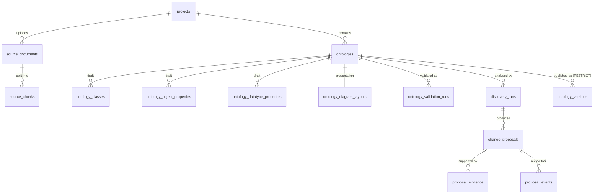
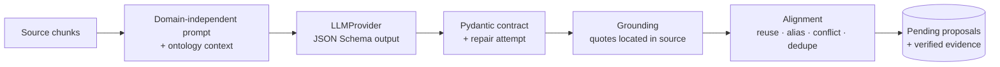
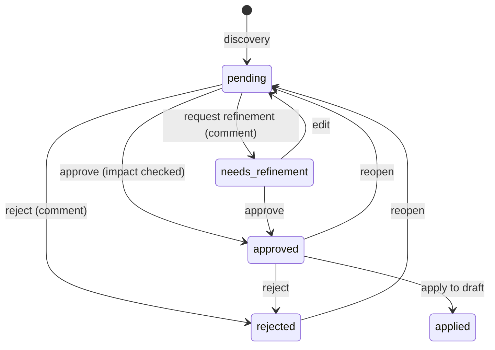

# Architecture

Ontology Lifecycle Studio supports **human-governed, AI-assisted ontology engineering and
knowledge-graph construction**.

> LLMs assist discovery. Domain experts govern meaning. Engineering systems enforce consistency.

This document describes the architecture as implemented through **Phase 2** and the extension
points reserved for Phase 3. Decisions and their rationale are in [DECISIONS.md](./DECISIONS.md);
the delivery plan is in [IMPLEMENTATION_PLAN.md](./IMPLEMENTATION_PLAN.md).

## 1. Principles

| Principle | How it is applied |
|---|---|
| The approved ontology is a long-lived asset | Ontologies evolve through draft revisions; published versions are immutable snapshots with write-once artifacts. |
| Humans govern meaning | AI output only ever becomes *pending proposals*. Nothing changes the draft until an SME approves and explicitly applies it; nothing ever changes a published version. |
| Engineering enforces consistency | Evidence grounding, deterministic alignment, validation impact on every proposal, a validation gate on publication, optimistic concurrency and an audit trail. |
| Do not trust the model blindly | Pydantic-validated structured output, quotes verified against the source, invented ids rejected, duplicate and conflicting suggestions re-classified. |
| Domain independence | No business classes in application logic or prompts. Supply Chain exists only as seed and sample *data*. |
| Real behaviour only | Every UI action calls a real API. Without a configured LLM, discovery is disabled - nothing is simulated. |

## 2. System context

```mermaid
flowchart LR
  user([Ontology engineer / SME]) --> ui[React SPA<br/>Vite · TanStack Query · React Flow]
  ui -- "/api (JSON, multipart)" --> api[FastAPI modular monolith]
  api --> db[(SQLite now<br/>PostgreSQL-ready)]
  api -- OpenAI-compatible --> llm[[LLM provider<br/>Ollama · OpenAI · Azure OpenAI · vLLM]]
  api --> artifacts[(Write-once artifact store<br/>JSON · Turtle)]
  api -. Phase 3 .-> graph[(Graph store<br/>local → Cosmos DB Gremlin)]
```

## 3. Repository layout

```text
.
├── backend/
│   ├── app/
│   │   ├── core/                settings, error envelope, id/time helpers
│   │   ├── db/                  declarative base, UTC type, engine/session, migration runner
│   │   ├── modules/
│   │   │   ├── projects/        project management
│   │   │   ├── ontology/        canonical schema model, authoring, drafts
│   │   │   ├── validation/      structural rules + validation runs
│   │   │   ├── activity/        append-only audit trail
│   │   │   ├── llm/             LLMProvider protocol, OpenAI-compatible provider, status API
│   │   │   ├── sources/         DocumentParser protocol, text/PDF parsing, chunking, uploads
│   │   │   ├── discovery/       LLM contract, prompts, grounding, alignment, discovery runs
│   │   │   ├── governance/      change proposals, evidence, decisions, impact, apply
│   │   │   ├── registry/        snapshots, diff, RDF export, artifact repository, publishing
│   │   │   └── seed/            Supply Chain demonstration data
│   │   ├── main.py              app factory, router composition, lifespan
│   │   └── cli.py               `migrate` / `seed` commands
│   ├── migrations/              Alembic 0001 (Phase 1), 0002 (Phase 2 + immutability triggers)
│   └── tests/                   pytest unit + API tests (LLM via an explicit test double)
├── frontend/
│   ├── src/features/ontology/   designer · discovery · review · validation · registry · governance
│   └── e2e/                     Phase 1 journey and Phase 2 governance journey (playwright-core)
├── samples/                     sample source documents for discovery
└── docs/
```

## 4. Backend

### 4.1 Modules (modular monolith)

| # | Module | Package | Status |
|---|---|---|---|
| 1 | Project & data source management | `projects`, `sources` | Projects ✔ · source documents for discovery ✔ · KG ingestion Phase 3 |
| 2 | Ontology domain model & authoring | `ontology` | ✔ |
| 3 | Ontology discovery & alignment | `llm`, `discovery` | ✔ Phase 2 |
| 4 | SME review & governance | `governance` | ✔ Phase 2 |
| 5 | Ontology validation | `validation` | Structural rules ✔ (reused for impact and publication) · SHACL Phase 3 |
| 6 | Registry & publishing | `registry` | ✔ Phase 2 |
| 7-10 | KG extraction, fact validation, graph, evaluation | - | Phase 3 |
| - | Audit trail (cross-cutting) | `activity` | ✔ |

Each module is layered as router (HTTP only) → service (use cases, transactions) → repository /
pure functions → ORM models, with Pydantic contracts. Pure, framework-free functions carry the
critical logic so it can be unit-tested: `validate_schema`, `ground_quote`, `align_findings`,
`apply_change`, `assess_impact`, `diff_snapshots`, `snapshot_to_graph`.

### 4.2 Canonical ontology model

`modules/ontology/domain.py` defines `ClassDefinition`, `ObjectPropertyDefinition`,
`DatatypePropertyDefinition` and `OntologySchema`. Elements have a stable `id` (used by all
references, proposals and diffs) and an editable `local_name` that forms the IRI
(`namespace + local_name`). The model is schema-only and independent of SQLAlchemy, React Flow,
LLM output and graph databases.

### 4.3 Persistence model



| Table | Purpose |
|---|---|
| `source_documents`, `source_chunks` | Extracted text (unique per project by SHA-256) and offset/page-tracked chunks. |
| `discovery_runs` | Baseline (draft revision or published version), documents, model, prompt version, progress, usage, discarded findings, status. |
| `change_proposals` | Type (ADD/REUSE/ALIAS/MODIFY/CONFLICT), status, target element, new element or field-level `{before, after}` changes, alignment notes, dependencies, the verbatim validated LLM finding, apply results. |
| `proposal_evidence` | Verified quote, context, document name, page and offsets - stored denormalised so evidence survives document deletion. |
| `proposal_events` | Append-only review timeline: created, commented, edited, approved, rejected, refinement requested, reopened, applied, apply failed (with actor and comment). |
| `ontology_versions` | Immutable published snapshot, content hash, version, validation summary, change summary, artifact checksums, publisher and notes. |

### 4.4 AI discovery pipeline



1. **Run** (`POST /ontologies/{id}/discovery-runs`, 202): validated, queued and executed by a
   background worker; the UI polls progress. One active run per ontology; runs interrupted by a
   restart are marked failed at startup.
2. **Prompting**: chunks are batched (`OLS_DISCOVERY_BATCH_CHARS`), labelled `C1..Cn`, and sent with
   a compact rendering of the baseline ontology (ids, labels, aliases, hierarchy, signatures).
   The prompt contains no business concepts and tells the model to treat the source as data.
3. **Structured output**: `LLMDiscoveryResponse` (Pydantic) is sent as JSON Schema
   (`$ref`s inlined for grammar-based engines) and every reply is validated; one repair prompt is
   sent on failure. A malformed batch is recorded and skipped; a transport error fails the run.
4. **Grounding**: each quote must be located in a chunk (case/whitespace/typographic-quote
   insensitive, strict fuzzy fallback for long quotes). Verified quotes are replaced by the exact
   source span with offsets and context. Findings without verified evidence are discarded and
   listed on the run with a reason.
5. **Alignment** (deterministic): labels, local names and aliases are normalised (case, camelCase,
   plurals) and matched exactly or by similarity.
   * ADD of an existing concept → REUSE, or ALIAS when the source term is a new synonym.
   * ADD of a relationship whose name exists with a different domain/range → CONFLICT.
   * Relationship with a literal range (`string`, `xsd:date`, …) → attribute of that datatype.
   * REUSE/ALIAS of an unknown concept → ADD; MODIFY/CONFLICT of an unknown element → discarded.
   * ALIAS colliding with another element's name → CONFLICT; no-op MODIFY → REUSE.
   * Near matches are flagged as possible duplicates; duplicate findings are merged.
   * Domain/range/parent references resolve to existing classes or to classes added in the same
     run (recorded as proposal dependencies); unresolved references are flagged.
   Every adjustment is recorded as an alignment note, and the original model action is kept.

### 4.5 SME review and governance



* **Impact** (`assess_impact`): applies the proposal - after its unapplied dependencies - to a
  copy of the current draft and runs `validate_schema` before and after; the delta (introduced and
  resolved issues) is shown with every proposal. Approval is refused when the proposal is not
  applicable or would introduce error-severity issues.
* **Edit**: SMEs can change the type, target, new element or proposed values; `before` values are
  rebased on the current draft. The original model output is never modified.
* **Apply** (`POST /ontologies/{id}/proposals/apply`): approved proposals are applied in
  dependency order with `apply_change` (references must exist, local names unique, hierarchy
  acyclic, scalar fields checked for drift since the proposal was created, list fields merged).
  Failures are isolated per proposal; successful changes are persisted in one transaction through
  `OntologyService.replace_schema`, which increments the draft revision and records activity.
  Published versions are never touched.

### 4.6 Registry and publication

* **Snapshot**: canonical JSON (elements sorted by id) with a SHA-256 content hash.
* **Publish** (`POST /ontologies/{id}/versions`): runs and persists a fresh validation and
  refuses on errors; refuses when the draft equals the latest version; requires a semantic version
  greater than the latest (suggested from the diff: removals and IRI/signature changes → major,
  additions → minor, documentation → patch); optional optimistic check of the reviewed draft
  revision; writes JSON and Turtle artifacts, then commits the version (artifacts are removed if
  the commit fails).
* **Immutability** in four layers: no update/delete endpoints; SQLAlchemy `before_update` /
  `before_delete` guards; database triggers (SQLite `RAISE(ABORT)`, PostgreSQL trigger function)
  and a `RESTRICT` foreign key from versions to ontologies; artifact files created exclusively,
  marked read-only and verified against their checksum on every export.
* **Compare** (`GET /ontologies/{id}/compare?base=&target=`): field-level diff between any two
  versions or a version and the draft.
* **RDF**: RDFLib OWL export - `owl:Ontology` with `owl:versionInfo`/`owl:versionIRI`, classes,
  object and datatype properties, `rdfs:subClassOf`, domain/range, XSD ranges, `skos:definition`,
  `skos:altLabel`, `dcterms:identifier` (stable element id), `owl:FunctionalProperty` for
  single-valued attributes and `owl:minCardinality 1` restrictions for required attributes.

### 4.7 API

All endpoints are under `/api` (OpenAPI at `http://127.0.0.1:8000/docs`); errors use
`{"error": {"code", "message", "details"}}`.

| Area | Endpoints |
|---|---|
| System | `GET /health`, `GET /llm/status?check=` |
| Projects | `GET/POST /projects`, `GET/PATCH /projects/{id}`, `GET /projects/{id}/activity` |
| Ontologies & draft | `GET/POST /projects/{id}/ontologies`, `GET/PATCH/DELETE /ontologies/{id}`, `GET/PUT /ontologies/{id}/draft` |
| Elements | CRUD under `/ontologies/{id}/classes`, `/object-properties`, `/datatype-properties` |
| Validation | `POST/GET /ontologies/{id}/validations`, `GET /ontologies/{id}/validations/latest` |
| Sources | `GET/POST(multipart) /projects/{id}/sources`, `GET/DELETE /sources/{id}` |
| Discovery | `POST/GET /ontologies/{id}/discovery-runs`, `GET /discovery-runs/{id}` |
| Governance | `GET /ontologies/{id}/proposals`, `GET /ontologies/{id}/proposals/stats`, `POST /ontologies/{id}/proposals/apply`, `GET/PATCH /proposals/{id}`, `POST /proposals/{id}/decision`, `POST /proposals/{id}/comments` |
| Registry | `GET /ontologies/{id}/publish-preview`, `GET/POST /ontologies/{id}/versions`, `GET /ontologies/{id}/versions/{vid}`, `GET /ontologies/{id}/versions/{vid}/export?format=turtle\|json`, `GET /ontologies/{id}/compare` |

### 4.8 Runtime

* `create_app(settings)` builds the engine, session factory, LLM provider (or `None`) and artifact
  repository per instance; tests replace the provider with a scripted test double.
* Startup applies migrations (`OLS_AUTO_MIGRATE`), fails interrupted discovery runs and seeds the
  demo project into an empty database.
* Configuration is environment-driven (`.env.example`); the LLM API key is a secret value that is
  never logged or returned by the API.

## 5. Frontend

Navigation keeps exactly three sections (Project Workspace, Ontology Studio, Knowledge Graph
Studio). All Phase 2 functionality lives in **Ontology Studio** tabs:

| Tab | Capabilities |
|---|---|
| Ontology Designer | Visual editing of the working copy (Phase 1). |
| AI Discovery | Provider status, source upload (drag & drop), run configuration (baseline draft or published version, SME focus), live run progress, results by type, discarded findings with reasons. |
| SME Review | Queue with status/type/run filters and search; detail with validation impact, current vs proposed values, alignment notes (including where alignment overrode the model), rationale, verified evidence highlighted in context, editing, decisions with mandatory comments for reject/refine, review timeline, comments, and "Apply approved to draft". |
| Validation | Structural validation of the saved draft (Phase 1). |
| Registry | Publication preview (validation gate, changes since the last version, breaking changes, suggested version), publish with release notes, version history with checksum-verified Turtle/JSON downloads, version comparison. |

The reviewer identifies themselves once (stored locally); the name is recorded on decisions,
comments, applications and publications. Applying and publishing are blocked while the designer
has unsaved changes; after applying, the draft reloads into the designer. The header shows the
latest published version, and the workspace summarises pending reviews, versions and sources with
links into the studio.

## 6. Extension points

| Interface | Implementations | Notes |
|---|---|---|
| `LLMProvider` | `OpenAICompatibleProvider` (tests: scripted double) | Structured output + repair; swap via configuration. |
| `DocumentParser` | `PlainTextParser`, `PdfParser` | Add OCR/Office parsers without touching callers. |
| `OntologyArtifactRepository` | `FilesystemArtifactRepository` | Blob storage (e.g. Azure Blob with immutability policies) later. |
| `GraphStore` | Phase 3 | Local graph first, Azure Cosmos DB Gremlin adapter later. |

Phase 3 adds the KG candidate-fact model (subject, predicate, object/literal, source location,
ontology **version**, extraction run, validation status and reasons), structural fact validation
and evidence grounding as separate dimensions, graph persistence and exploration, and evaluation
that generates change proposals into the existing SME review queue.
