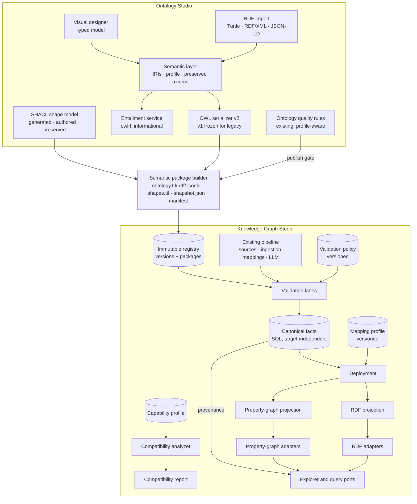
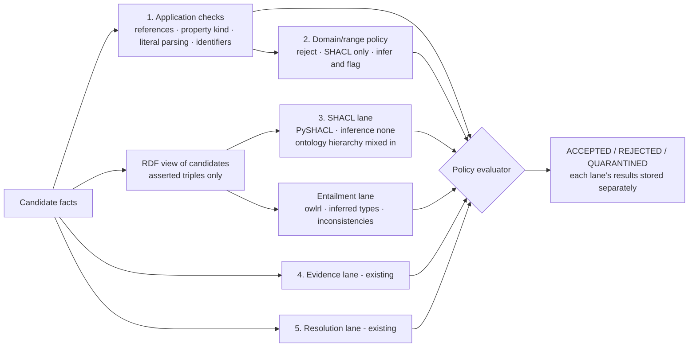
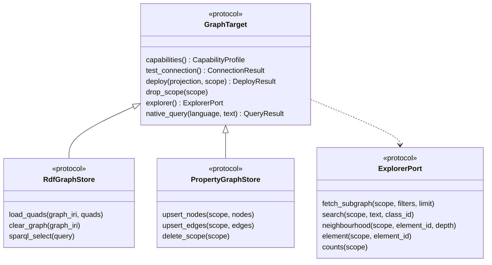
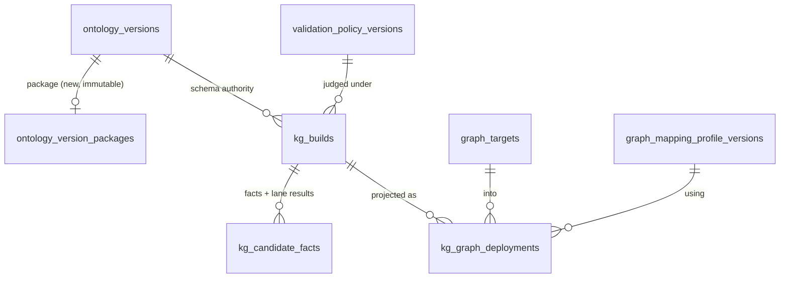

# Phase 4 Architecture Proposal - Standards-Based Semantic Modeling and Database-Agnostic Knowledge Graph Engineering

| | |
|---|---|
| **Status** | **Approved and implemented** (Phase 4 complete). Delivered scope, deviations and deferred items: [IMPLEMENTATION_PLAN.md](./IMPLEMENTATION_PLAN.md#phase-4---standards-based-semantics-and-database-agnostic-knowledge-graphs-day-4); decisions ADR-035 - ADR-053 in [DECISIONS.md](./DECISIONS.md). The assessment below is kept as written before implementation. |
| **Date** | 2026-10-11 |
| **Baseline** | Commit `a1076ef` (Phase 3 complete) |
| **Scope** | Architecture and compatibility assessment; target architecture; migration plan; roadmap |

Related documents: [ARCHITECTURE.md](./ARCHITECTURE.md) (as built through Phase 3),
[DECISIONS.md](./DECISIONS.md) (ADR-001 - ADR-034), [IMPLEMENTATION_PLAN.md](./IMPLEMENTATION_PLAN.md).

## How this assessment was produced

All findings come from reading the repository and from read-only checks. No application code,
database, migration or dependency was changed.

| Check | Result |
|---|---|
| Backend test suite (temporary databases only) | **169 passed** |
| In-memory export of the seed ontology with the current serializer | 337 triples; RDF/XML, JSON-LD and Turtle re-parse to an isomorphic graph (RDFLib 7.6.0) |
| Search for RDF parsing/import code in `backend/app` | None |
| Installed semantic libraries | `rdflib 7.6.0`; **no** `pyshacl`, `owlrl`, graph-database drivers |
| Local graph infrastructure | No Docker, Java, Neo4j, Fuseki or GraphDB; ports 3030, 7200, 7687, 8182 closed |
| PyPI metadata (no installation) | `pyshacl 0.40.1` requires `rdflib>=7.3,<8` and `owlrl>=7.6.2,<8`; `owlrl 7.6.2` requires `rdflib>=7.6.0`; `neo4j 6.4.0`; `pyoxigraph 0.5.11` (no dependencies) |

**Labels used throughout**

* **[V]** verified in the repository or by execution.
* **[A]** assumption, or a vendor/standard capability that must be verified for the specific
  product version before it is relied on.
* **[R]** recommendation.

Code references are links with line numbers (for example
[domain.py#L60](../backend/app/modules/ontology/domain.py#L60)).

---

## Executive summary

### 1. Recommended canonical semantic model

**Option C - a hybrid with one clearly defined authority per construct.** [R]

* The existing typed Pydantic model (`OntologySchema`) remains authoritative for a defined subset,
  the **OLS Semantic Profile 1**: classes, subclass hierarchy, object/datatype properties,
  subproperties, inverse, equivalence, disjointness, property characteristics, a structured
  restriction list, annotations, persisted IRIs and prefixes.
* Every construct outside the profile is kept in a **preserved-axiom store**: the original triples
  (with their blank-node closure) anchored to the element ids they mention.
* RDF/OWL artifacts are a deterministic merge of model triples and preserved triples. RDFLib is
  used for parsing, serialization and graph comparison - not as the editing store.

**Rationale.** Drafts, diffs, SME proposals, validation rules, AI discovery alignment and the KG
pipeline all operate on the typed model and stable element ids. Making an RDF graph authoritative
(option B) would rewrite all of them and make hashing/diffing depend on blank-node
canonicalization, for no gain the hybrid cannot deliver. Extending the model alone (option A)
would silently lose imported constructs. The hybrid gives full round-trip fidelity with additive
changes only.

### 2. Changes required to the existing architecture

1. **Persist IRIs.** Today IRIs are computed as `namespace + local_name` at export
   ([rdf.py#L42](../backend/app/modules/registry/rdf.py#L42)); renaming changes the IRI. Persist an
   IRI per element and lock it once published. Add an ontology header (ontology IRI, prefix map,
   imports, annotations).
2. **Separate OWL axioms from validation constraints.** `required` and `multi_valued` are
   validation intent but are exported as `owl:minCardinality 1` and `owl:FunctionalProperty`
   ([rdf.py#L77](../backend/app/modules/registry/rdf.py#L77)) - every single-valued attribute
   becomes functional (17 of 17 in the seed). They become SHACL constraints; OWL characteristics
   become explicit, separately chosen flags.
3. **Make KG domain/range enforcement an explicit, versioned validation policy.** Today
   `rdfs:domain`/`rdfs:range` are applied as closed-world rejection rules
   ([kg/validation.py#L238](../backend/app/modules/kg/validation.py#L238)). The behaviour is kept
   (policy `application-strict/1`, the default) but is no longer conflated with RDFS semantics.
4. **Make the "domain and range required" quality rule profile-aware**
   ([rules.py#L380](../backend/app/modules/validation/rules.py#L380)) so standard ontologies with
   open domains can be imported and published.
5. **Add RDF import, multi-format export, SHACL, and an OWL RL entailment preview.**
6. **Split graph persistence into projection + adapters.** `GraphStore` is a Gremlin-shaped
   property-graph contract ([store.py#L20](../backend/app/modules/graph/store.py#L20)). The
   canonical accepted facts already exist in SQL and become the single source for target-specific
   projections.
7. **Separate builds from deployments.** A build (extraction + validation) is target-independent;
   a deployment projects one build to one graph target with one mapping profile.
8. **Add an immutable semantic package per published version**, in a new side table - the
   immutable `ontology_versions` table is never altered.

### 3. Proposed RDF, OWL and SHACL capabilities

| Area | MVP capability |
|---|---|
| RDF | Import Turtle, RDF/XML, JSON-LD (OWL in RDF/XML included); export the same three; RDF/OWL viewer with triples and IRIs; local SPARQL over a build's RDF projection |
| RDFS/OWL | Named class hierarchy, subproperties, single domain/range, inverse, equivalent classes/properties, disjoint classes, functional/inverse-functional/transitive/symmetric/asymmetric/reflexive/irreflexive characteristics, some/all/hasValue/min/max/exact cardinality restrictions (structured), `owl:deprecated`, `owl:imports` recorded (not resolved), more XSD datatypes. Everything else preserved verbatim and labelled. **Not** claimed as "OWL 2 support". |
| Reasoning | OWL 2 RL / RDFS entailment preview and OWL RL inconsistency detection with `owlrl` - informational unless a validation policy explicitly uses it. No DL reasoner. |
| SHACL | Node and property shapes; target class; datatype, class, min/max count, allowed values (`sh:in`), pattern, node kind, ranges and lengths; severity and messages; shapes generated from model constraints (marked as generated, frozen at publish) plus SME-authored shapes; imported unsupported SHACL preserved; PySHACL engine with **inference disabled**; reports mapped back to facts and entities. |

### 4. Multi-graph database adapter design

* A shared **`GraphTarget`** contract (capabilities, connection test, deploy, drop scope, explorer
  port, optional read-only native query) with two specialisations: **`RdfGraphStore`** and
  **`PropertyGraphStore`**. No artificial universal query language.
* **Projections** are pure functions: canonical facts + semantic package + mapping profile →
  RDF quads, or nodes/edges.
* **Capability profiles** describe each target (data model, query languages, multi-typing, named
  graphs, reasoning, SHACL, statement metadata, constraints, partitioning, limits). A
  **compatibility analyzer** produces a **Graph Compatibility Report** (native / transformed /
  partial / unsupported / semantic loss) before deployment; deployments with semantic loss need
  an explicit, recorded acknowledgement.
* **Provenance is always resolved from the canonical fact store**, so it behaves identically on
  every database.
* Adapters: existing SQL graph store (local property graph, dev/test), a new local RDFLib store
  (dev/test), a standard **SPARQL 1.1 HTTP adapter** (Fuseki, GraphDB, Oxigraph server; Neptune to
  verify) and a **Neo4j adapter** for the proof of concept; Cosmos DB Gremlin and TigerGraph later.

### 5. Proposed React UI enhancements

No new top-level navigation.

* **Ontology Studio:** two new tabs - **RDF / OWL** (header and prefixes, generated Turtle,
  triples, import with report, preserved axioms, entailment preview) and **Shapes** (SHACL shape
  designer, preview, validate sample data). An **Advanced semantics** section in the existing
  inspectors (the React Flow canvas only gains small badges). Validation gains shape and reasoning
  checks; Registry shows package contents and multi-format downloads.
* **Knowledge Graph Studio:** a **Graph target** step in the Pipeline (data model, target,
  connection test, mapping profile, mapping preview, compatibility report), deployments per build,
  a target picker in the Graph Explorer, per-lane results in Fact Validation, and a new read-only
  **Query** tab in the target's native language.

### 6. Database migration risks

* `ontology_versions` is protected by ORM guards and database triggers; any `UPDATE` or SQLite
  table rebuild would fail or drop the triggers. **New information goes into side tables only.**
* Earlier draft revisions were never stored (only a revision counter and change counts) - they
  cannot be migrated.
* The intent behind existing `required` / `multi_valued` values (OWL axiom vs data constraint) is
  ambiguous and needs an SME decision (D2).
* Existing KG builds and facts were judged under Phase 3 rules; they are labelled
  `application-strict/1` / "SHACL not evaluated" and **never re-judged**.
* Instance IRIs for existing builds depend on a data namespace that does not exist yet; existing
  graphs stay "local SQL only" until explicitly redeployed.
* All migrations are additive and reversible; downgrades drop only Phase 4 structures (and the
  data in them).

### 7. Phase 4 implementation milestones

| Milestone | Scope | Relative complexity |
|---|---|---|
| 4.1 Semantic model foundation | IRIs, header, profile extensions, preserved axioms, import/export, packages, entailment preview | L |
| 4.2 SHACL engineering | Shape model, generation, PySHACL engine, validation policies, KG SHACL lane | L |
| 4.3 Semantic modeling UI | RDF/OWL tab, Shapes tab, advanced inspectors, package view, per-lane fact view | M-L |
| 4.4 Graph model abstraction | Contracts, projections, mapping and capability profiles, compatibility report, deployments, local RDF adapter | L |
| 4.5 Multi-graph proof of concept | SPARQL 1.1 HTTP adapter + Neo4j adapter against real databases | L + infrastructure |
| 4.6 Enterprise graph extensions | Cosmos DB Gremlin, TigerGraph, Neptune, GraphDB rulesets, RDF-star provenance | XL (about M per adapter) |

### 8. Decisions requiring approval

| ID | Decision | Recommendation |
|---|---|---|
| D1 | Canonical model | Option C (hybrid) |
| D2 | `required` / `multi_valued` | Become SHACL `minCount` / `maxCount`; OWL axioms only through explicit characteristics; flagged as a semantic-profile change at next publish |
| D3 | Element IRIs | Persisted, locked after first publication |
| D4 | Shape versioning | Shapes are part of the ontology version package |
| D5 | Default validation policy | `application-strict/1` (exact Phase 3 behaviour) |
| D6 | Location of graph mappings | Separate deployment/mapping registry in Knowledge Graph Studio |
| D7 | Instance IRIs | `{data_namespace}e/{vertex_id}` (stable hash) |
| D8 | Proof-of-concept databases and infrastructure | Requires your choice - nothing is installed locally |
| D9 | New dependencies | `owlrl` (4.1), `pyshacl` (4.2), `neo4j` (4.5); `pyoxigraph` only if chosen |
| D10 | Import scope in the MVP | Import into a new ontology or an empty draft only |
| D11 | Reasoning | OWL RL entailment preview; affects fact status only through explicit policy |

### Backward-compatibility and semantic-loss risks (summary)

| Risk | Type | Mitigation |
|---|---|---|
| Next publish after D2 removes `owl:FunctionalProperty` / `owl:minCardinality` axioms that v1.x artifacts asserted | Semantic change for consumers of the OWL artifact | Publish diff flags a *semantic profile change*; SME chooses explicit characteristics where the axiom is intended; earlier artifacts unchanged |
| Imported constructs outside the profile | Potential loss | Preserved verbatim; round-trip isomorphism tests; orphaned axioms block publication until resolved |
| Renaming a published element's local name used to change its IRI | Identity change | IRIs persisted and locked (D3) |
| Property-graph targets cannot represent language tags, multi-typing (single-label stores), OWL restrictions, inverse/transitive semantics, named graphs, blank nodes | Semantic loss in projection | Compatibility report; acknowledgement required; ontology never altered |
| Legacy builds have no SHACL results, no instance IRIs | Incomplete traceability | Explicit "pre-Phase 4" labelling; no re-judgement; optional explicit redeployment |
| Earlier draft revisions not stored | Unrecoverable history | Documented; Phase 4 does not add draft history unless requested |
| SQLite batch migration on tables with triggers | Silent trigger loss | Never alter `ontology_versions`; new package table gets its own triggers; migration tests assert triggers |

---

## 1. Current architecture assessment

### 1.1 The canonical ontology model today

| # | Question | Finding | Evidence |
|---|---|---|---|
| 1 | How are identifiers and namespaces represented? | **[V]** One `namespace` and one `prefix` per ontology (free strings, checked by quality rules `NAMESPACE_INVALID` / `NAMESPACE_MISSING_SEPARATOR`). Every element has a stable `id` (pattern `^[A-Za-z0-9][A-Za-z0-9_.:\-]{0,63}$`) and an editable `local_name`. | [models.py#L30](../backend/app/modules/ontology/models.py#L30), [domain.py#L14](../backend/app/modules/ontology/domain.py#L14) |
| 2 | Do classes and properties have stable IRIs? | **[V] No.** IRIs are computed at export as `namespace + local_name`; renaming `local_name` changes the IRI and the version diff marks it as breaking. The stable id is exported as `dcterms:identifier`. The ontology IRI is the namespace without the trailing `#`, `/` or `:`; `versionIRI` is `{ontology IRI}/{version}`. Elements outside the ontology namespace (e.g. `schema:Person`) cannot be represented. | [rdf.py#L42](../backend/app/modules/registry/rdf.py#L42), [rdf.py#L49](../backend/app/modules/registry/rdf.py#L49), [rdf.py#L11](../backend/app/modules/registry/rdf.py#L11), [rdf.py#L36](../backend/app/modules/registry/rdf.py#L36), [diff.py#L13](../backend/app/modules/registry/diff.py#L13) |
| 3 | Is the canonical model JSON-based? | **[V] Yes.** Pydantic `OntologySchema`; drafts persisted as rows in three element tables; published versions store a canonical JSON snapshot (elements sorted by id) and its SHA-256. | [domain.py#L92](../backend/app/modules/ontology/domain.py#L92), [snapshot.py#L26](../backend/app/modules/registry/snapshot.py#L26), [snapshot.py#L53](../backend/app/modules/registry/snapshot.py#L53) |
| 4 | Is RDFLib used, and for what? | **[V] Export only** - `snapshot_to_graph` / `to_turtle` produce the Turtle artifact at publish. No parsing or import exists. RDFLib 7.6 reads and writes Turtle, RDF/XML and JSON-LD; the seed export round-trips isomorphically in all three. | [rdf.py#L15](../backend/app/modules/registry/rdf.py#L15), [registry/service.py#L234](../backend/app/modules/registry/service.py#L234) |
| 5 | Which RDF/RDFS/OWL constructs are represented? | **[V]** `owl:Ontology` (label, description, `versionInfo`, `versionIRI`, issued, comment); `owl:Class`; `rdfs:subClassOf` between named classes (multiple parents); `owl:ObjectProperty` with one domain and one range; `owl:DatatypeProperty` with 7 XSD ranges; `rdfs:label`, `skos:definition`, `skos:altLabel`, `dcterms:identifier`, `rdfs:isDefinedBy`; `owl:FunctionalProperty` and `owl:minCardinality 1` generated from two attribute flags. Seed: 337 triples, 11 classes, 17 functional datatype properties, 8 cardinality restrictions. | [rdf.py#L56](../backend/app/modules/registry/rdf.py#L56) |
| 6 | What is lost in serialization / deserialization? | **[V]** Export: only presentation data (layout, sort order) - correctly. Deserialization: everything, because there is no importer. Constructs the model cannot hold are listed in §2. | - |
| 7 | Lossless import/export for supported features? | **[V] Not today** (no importer). Export → re-import of OLS artifacts is feasible because `dcterms:identifier` carries element ids. | - |
| 8 | Complete immutable snapshots for drafts and versions? | **[V] Published versions: yes** - snapshot plus JSON and Turtle artifacts, protected by API (no mutation endpoints), ORM guards, SQLite/PostgreSQL triggers, a `RESTRICT` foreign key and read-only, hash-verified files. **Drafts: no** - only the current draft plus a revision counter; the activity log stores change *counts*, not content. | [registry/models.py#L51](../backend/app/modules/registry/models.py#L51), [0002 migration#L183](../backend/migrations/versions/20261011_0002_phase2_discovery_governance_registry.py#L183), [artifacts.py#L59](../backend/app/modules/registry/artifacts.py#L59), [artifacts.py#L77](../backend/app/modules/registry/artifacts.py#L77) |
| 9 | Do schema models mix ontology semantics with SHACL-like rules? | **[V] Yes**, in three places - see §1.3. | - |
| 10 | Can the structures accommodate standards-based extensions without a rewrite? | **[V] Mostly yes**, with three specific constraints - see §1.2. | - |

### 1.2 Extension constraints in the draft round trip [V]

| Behaviour | Consequence for Phase 4 | Evidence |
|---|---|---|
| The frontend keeps whole element objects and patches them by object spread | New element-level fields survive visual edits once the API returns them | [model.ts#L56](../frontend/src/features/ontology/draft/model.ts#L56) |
| `toDoc` rebuilds ontology metadata from four fixed fields | New ontology-level fields (prefixes, imports, annotations) would be **dropped on save** unless `toDoc` is extended | [model.ts#L41](../frontend/src/features/ontology/draft/model.ts#L41) |
| Draft save is a whole-document sync that **deletes elements missing from the request** | Advanced axioms must be stored on elements (round-tripped) or in a separate table that save does not touch; deletions must be reconciled (orphan detection) | [ontology/service.py#L286](../backend/app/modules/ontology/service.py#L286), [ontology/service.py#L452](../backend/app/modules/ontology/service.py#L452) |
| Backend sync uses explicit field lists; elements use `extra="forbid"` | Every new field must be added to the field tuples, ORM columns and Pydantic models together | [repository.py#L30](../backend/app/modules/ontology/repository.py#L30), [domain.py#L61](../backend/app/modules/ontology/domain.py#L61), [schemas.py#L101](../backend/app/modules/ontology/schemas.py#L101) |
| Governance `apply_change` deep-copies the schema and edits only whitelisted fields | New fields are preserved when proposals are applied; extending `EDITABLE_FIELDS` is needed only if proposals should edit them | [apply.py#L28](../backend/app/modules/governance/apply.py#L28), [apply.py#L104](../backend/app/modules/governance/apply.py#L104) |

### 1.3 Conflicts with Semantic Web semantics [V]

**C1 - Validation intent exported as OWL axioms.**
`DatatypePropertyDefinition.required` and `multi_valued`
([domain.py#L88](../backend/app/modules/ontology/domain.py#L88)) express data-quality intent: the
KG pipeline quarantines conflicting values of single-valued attributes
([kg/validation.py#L421](../backend/app/modules/kg/validation.py#L421)) and reports missing required
values as a completeness metric. The exporter turns them into OWL axioms
([rdf.py#L77](../backend/app/modules/registry/rdf.py#L77)):

| Flag | Exported as | OWL (open-world) meaning | What the application means |
|---|---|---|---|
| `multi_valued = false` (default) | `owl:FunctionalProperty` | At most one value; two *different* literal values make the ontology inconsistent | "Only one value is accepted per entity" - a data constraint |
| `required = true` | `rdfs:subClassOf [owl:onProperty p; owl:minCardinality 1]` | Every instance *has* a value somewhere; a missing value is **not** an error | "A value must be present in the data" - a data constraint |

An existing test asserts this export ([test_registry.py#L89](../backend/tests/test_registry.py#L89)).

**C2 - RDFS domain/range used as closed-world rejection rules.**
[assess_relationship_structure](../backend/app/modules/kg/validation.py#L238) rejects a fact whose
subject or object class does not match the property's domain or range, and diagnoses reversed
direction. Under RDFS, `P-200 supplies S-002` (with domain Supplier, range Product) is not a
violation: it **entails** `P-200 rdf:type Supplier` and `S-002 rdf:type Product`. It becomes a
contradiction only with an `owl:disjointWith` axiom between Supplier and Product, which the seed
ontology does not declare. The rejection is a sound *application policy* and must be preserved -
as an explicit, named, versioned policy.

**C3 - Mandatory domain and range as an ontology quality rule.**
`PROPERTY_DOMAIN_MISSING` and `PROPERTY_RANGE_MISSING` are errors
([rules.py#L380](../backend/app/modules/validation/rules.py#L380),
[rules.py#L409](../backend/app/modules/validation/rules.py#L409)) and block publication. OWL allows
properties without domain or range, and many standard ontologies rely on that; imported ontologies
of that kind could never be published.

### 1.4 Knowledge-graph persistence today [V]

| Aspect | Finding | Evidence |
|---|---|---|
| Canonical accepted facts | `kg_entities` and `kg_candidate_facts` (status, structural/evidence/resolution results, sources, datatype, canonical value) are stored in SQL independently of the graph store - **already a database-neutral fact model** | [kg/models.py#L104](../backend/app/modules/kg/models.py#L104), [kg/models.py#L154](../backend/app/modules/kg/models.py#L154) |
| `GraphStore` contract | Gremlin-shaped property graph: one `label` per vertex, `properties` dictionary, `out_id`/`in_id` edges, `fact_ids`/`source_ids` provenance arrays, a `graph_id` scope string | [store.py#L20](../backend/app/modules/graph/store.py#L20), [store.py#L49](../backend/app/modules/graph/store.py#L49) |
| Vertex label | Class `local_name` | [orchestrator.py#L793](../backend/app/modules/kg/orchestrator.py#L793) |
| Attribute values | Untyped strings in lists, keyed by property `local_name` (datatype recoverable from facts and the version) | [orchestrator.py#L806](../backend/app/modules/kg/orchestrator.py#L806) |
| Edge identity | Hash of subject, predicate id and object | [orchestrator.py#L236](../backend/app/modules/kg/orchestrator.py#L236) |
| Instance identity | Deterministic hash of class id, key namespace and business key (`v…`); no IRIs | [resolution.py#L39](../backend/app/modules/kg/resolution.py#L39) |
| Class membership | One class per entity | [kg/models.py#L115](../backend/app/modules/kg/models.py#L115) |
| Build traceability | Published version id, frozen configuration including the version content hash, `graph_store = "sql"` | [kg/models.py#L61](../backend/app/modules/kg/models.py#L61), [kg/service.py#L638](../backend/app/modules/kg/service.py#L638) |
| Adapter wiring | One factory on application state | [main.py#L106](../backend/app/main.py#L106) |

**Assessment.** The contract does not assume SQL, but it does assume a labelled property graph. It
has no notion of IRIs, typed or language-tagged literals, multiple types, named graphs or
statement metadata, so an RDF store cannot implement it faithfully. The explorer DTOs (`GraphRead`,
`GraphElementDetail`) are close to neutral and can be kept.

### 1.5 Reusable assets

| Asset | Reuse |
|---|---|
| Typed canonical model with stable element ids | Remains authoritative for the supported profile |
| `snapshot_to_graph` | Frozen as the **v1 (legacy) serializer** so existing versions keep producing identical bytes |
| Immutable registry (triggers, hashes, write-once files) | Pattern reused for semantic packages, validation policies and mapping profiles |
| Canonical accepted facts | Source for every target-specific projection |
| Deterministic instance and edge ids | Basis of instance IRIs and idempotent writes to every target |
| Fact validation lanes (structural, evidence, resolution) | Kept; domain/range becomes a named policy; SHACL added as a separate lane |
| Explorer DTOs and UI | Become the shared explorer contract (plus a `class_ids` list) |
| `SqlGraphStore` | Local property-graph adapter for development and contract tests |
| Ontology quality rules | Kept for the ontology (TBox); made profile-aware |
| Governance (proposals, evidence, review, apply) | Unchanged; whitelist extended where proposals may edit new fields |

---

## 2. Semantic standards gap analysis

Categories: **✅** supported today · **🟢** easy (additive field or serializer change) ·
**🟠** significant (model, validation, UI and KG impact) · **⏸** defer, but **preserve verbatim on
import and export**.

### 2.1 RDF, RDFS and OWL constructs

| Construct | Today | Phase 4 category | Notes |
|---|---|---|---|
| `owl:Class`, named subclass hierarchy | ✅ | ✅ | Cycle detection exists |
| Object property, single domain and range | ✅ | ✅ | |
| Datatype property, single domain, XSD range | ✅ (7 types) | 🟢 more types | float, double, int, long, time, gYear, duration; `rdf:langString` with 🟠 language support |
| Labels and descriptions | ✅ single plain literal | ✅ / 🟠 | Multilingual labels are 🟠; MVP preserves extra `@lang` labels and displays them |
| Ontology IRI, `versionIRI`, prefix map, ontology annotations | Derived / single prefix | 🟢 | Explicit header |
| Persisted, stable element IRIs | ❌ computed | 🟢 model, 🟠 rename UX and diff | §3.5 |
| References to terms from other vocabularies | ❌ | 🟠 | Read-only "referenced terms" with their own IRI |
| `owl:imports` | ❌ | 🟢 record | Resolving and merging the import closure is ⏸ |
| `rdfs:subPropertyOf` | ❌ | 🟢 model / 🟠 KG | A fact using a subproperty must satisfy shapes on the parent property |
| `owl:inverseOf` | ❌ | 🟢 | |
| Property characteristics (functional, inverse-functional, transitive, symmetric, asymmetric, reflexive, irreflexive) | Implicit (C1) | 🟢 explicit flags | Each flag shows its entailment in the UI |
| `owl:equivalentClass`, `owl:equivalentProperty` (named) | ❌ | 🟢 | |
| `owl:disjointWith`, `owl:AllDisjointClasses` | ❌ | 🟢 | `owl:disjointUnionOf` ⏸ |
| Restrictions: `someValuesFrom`, `allValuesFrom`, `hasValue`, min/max/exact cardinality, qualified forms | Implicit `minCardinality 1` | 🟠 | Structured restriction list on classes, edited in the inspector |
| Class expressions: `unionOf`, `intersectionOf`, `complementOf`, `oneOf` | ❌ | ⏸ preserve | Including union domains/ranges |
| Multiple `rdfs:domain` / `rdfs:range` (intersection semantics) | ❌ | ⏸ preserve + warning | The model keeps one domain and one range |
| Custom annotation properties | ❌ | ⏸ preserve and display | |
| Named individuals, enumerations | ❌ | ⏸ preserve | |
| `owl:deprecated` | ❌ | 🟢 | Used when IRIs are retired |
| SWRL, property chains, `owl:hasKey`, datatype facets, punning | ❌ | ⏸ preserve | |
| SKOS concept schemes, PROV-O | Annotations only | ⏸ | Future extensions |

### 2.2 Serializations, validation, reasoning and query

| Capability | Today | Phase 4 |
|---|---|---|
| Export Turtle | ✅ | ✅ (new v2 profile; v1 frozen for legacy versions) |
| Export RDF/XML ("OWL/RDF") and JSON-LD | ❌ | 🟢 - verified round trip in RDFLib |
| OWL/XML, Manchester syntax, OBO | ❌ | ⏸ - not supported by RDFLib; would need an external tool |
| Import Turtle, RDF/XML, JSON-LD | ❌ | 🟠 - parsing is easy; classification, preservation and reporting are the work |
| SHACL | ❌ | 🟠 first-class subsystem (§4.4) |
| SHACL-SPARQL, SHACL Advanced Features | ❌ | ⏸ preserve |
| Reasoning | ❌ | 🟢 OWL 2 RL / RDFS entailment preview with `owlrl` (§3.6) |
| SPARQL | ❌ | 🟢 local (RDFLib) and through RDF targets |
| Multiple class membership in KG data | ❌ | 🟠 fact model, resolution and explorer |
| Language-tagged literals in KG data | ❌ | ⏸ (reported as unsupported) |

### 2.3 Claim policy [R]

The supported subset is called the **OLS Semantic Profile 1**: a subset of OWL 2 DL constructs,
listed explicitly in the product. The product never states "OWL 2 support". Constructs outside the
profile are preserved verbatim, shown as *preserved (not editable)*, and exported unchanged.

### 2.4 Axiom versus constraint - the distinction the design enforces

| Statement | As an OWL/RDFS axiom (open world, entailment) | As a SHACL constraint (validation of a data graph) |
|---|---|---|
| `supplies` has domain Supplier | Any subject of `supplies` *is* a Supplier (inferred) | A subject of `supplies` that is not typed Supplier is a violation |
| `sku` is functional | Two different values make the ontology inconsistent | `sh:maxCount 1`: more than one value is a violation |
| `issuedTo` (object property) is functional | Two objects are inferred to be the **same individual** (`owl:sameAs`) - not an error | `sh:maxCount 1`: a violation |
| Purchase Order requires `orderNumber` | Every Purchase Order has *some* order number, possibly unknown - never an error | `sh:minCount 1`: missing value is a violation |
| Supplier and Product are disjoint | An individual typed as both makes the ontology inconsistent | `sh:not [sh:class Product]` on Supplier: a violation |

Design rule [R]: **OWL axioms are never converted into SHACL automatically.** Shapes are generated
only from the application's explicit data-constraint fields (`required`, `multi_valued`,
datatype, and - under a policy - the domain/range signature). An SME may opt to enforce a specific
OWL axiom as a constraint; the generated shape then records which axiom it enforces.

---

## 3. Canonical model recommendation

### 3.1 Options compared

| Criterion | A. Extend the typed model and generate RDF | B. RDFLib graph authoritative, projections for the editor | **C. Hybrid with defined authority (recommended)** |
|---|---|---|---|
| Round-trip fidelity | Loses everything outside the model | Full | Full: the profile via the model, the rest as preserved triples |
| MVP performance | Excellent | Good; blank-node canonicalization needed for hashing and diffs | Excellent |
| Maintainability | High | Low - rewrites draft persistence, diff, proposals, apply, quality rules, `OntologyView`, discovery alignment | High |
| Data migration | Additive | Full conversion of drafts and a parallel representation for versions | Additive |
| Existing UI | Unchanged | Every view needs a projection layer | Unchanged; advanced panels added |
| Governance (field-level proposals, diffs) | Unchanged | Must be re-expressed as triple patches | Unchanged; preserved axioms diffed as triple sets |
| Main risk | Silent semantic loss | Rewrite risk, regressions in verified Phase 1-3 behaviour | Import classification correctness (testable) |

### 3.2 Recommendation: option C [R]

* **Typed model** - authoritative for the OLS Semantic Profile. Extended with:
  * `iri` per element;
  * a structured `semantics` sub-document per element (subproperties, inverse, characteristics,
    equivalents, disjoints, restrictions, deprecation);
  * an ontology header (ontology IRI, version IRI template, prefix map, `owl:imports`, annotations).
* **Preserved-axiom store** - authoritative for everything else. Each *axiom group* holds the
  original triples plus their blank-node closure, its classification (for example "union domain",
  "SWRL rule", "custom annotation"), the element ids it references, its origin (import id) and a
  status (`active` / `orphaned`).
* **RDF artifacts** - a deterministic merge of model-generated triples and preserved triples,
  serialized by RDFLib.

### 3.3 Import algorithm [R]

1. Parse the file (Turtle, RDF/XML or JSON-LD) and record its prefixes.
2. Identify the ontology header (`owl:Ontology`, version IRI, imports, annotations).
3. Identify classes and properties. Element id: the value of `dcterms:identifier` when present and
   valid (OLS round trip), otherwise a minted id; the IRI is stored separately.
4. Consume every triple that matches a profile pattern into the model, marking it consumed.
5. Group the remaining triples by blank-node closure into preserved axiom groups, anchored to the
   elements they mention.
6. Produce an **import report**: consumed, preserved and warning counts with explanations (for
   example "multiple `rdfs:domain` on `p`: intersection semantics, preserved; the editor shows no
   domain"). **Nothing is dropped.**
7. Create a new ontology (or fill an empty draft - D10) and record the import in the activity log.

### 3.4 Fidelity guarantee and synchronization [R]

* **Guarantee (tested):** `export(import(file))` is graph-isomorphic to `file`
  (`rdflib.compare.isomorphic`), with no normalization of the original form.
* Preserved axioms live in their own table, so the whole-draft save never touches them.
* Deleting an element referenced by a preserved axiom marks the axiom **orphaned**; publication
  requires an SME decision (remove the axiom or restore the element). Nothing is silently deleted.
* The inspector shows "N preserved axioms reference this element", because edits to an element
  cannot always be checked against arbitrary preserved axioms.
* If an SME edits a construct that was absorbed from an import, the export reflects the edit; the
  version diff shows the triple-level change.

### 3.5 IRI policy [R]

* An IRI is minted when an element is created (`namespace + local_name`) and persisted.
* Once the element appears in a published version, its IRI is **locked**: renaming changes the
  label and local name only.
* Changing a published IRI is an explicit, breaking "re-identify" action that also emits
  `owl:deprecated true` on the old IRI and an equivalence axiom to the new one.
* Imported elements keep their source IRIs, including IRIs outside the ontology namespace.
* Existing drafts are backfilled deterministically; published versions are not touched (their IRIs
  are derivable and identical).

### 3.6 Reasoning in the MVP [R]

* **No DL reasoner** (HermiT, ELK, Pellet are Java tools).
* **`owlrl`** (pure Python, required by PySHACL anyway) provides:
  * an **entailment preview**: inferred subclass relations and types, shown in the RDF/OWL tab and
    in fact validation as *inferred*;
  * **OWL 2 RL inconsistency detection**, for example an individual in two disjoint classes or two
    distinct values of a functional datatype property.
* Inferred triples are **never** written to a graph target and never accept or reject a fact unless
  a validation policy explicitly maps a reasoning result to a status.
* Performance [A]: `owlrl` is fast on ontology-sized graphs and acceptable on MVP-sized builds;
  large builds run it on demand only.

### 3.7 Resolution of conflict C1 [R, requires D2]

* `required` and `multi_valued` keep their names, columns and UI switches (no API break) but are
  defined as **data constraints**: they generate `sh:minCount 1` / `sh:maxCount 1`.
* OWL axioms come only from explicit characteristics (for example `functional`).
* Draft migration does **not** set `functional` automatically; the next publish preview lists
  "semantic profile change: N `owl:FunctionalProperty` and M `owl:minCardinality` axioms are no
  longer asserted; equivalent SHACL constraints are included" and asks the SME to opt in where an
  OWL axiom is intended.
* Legacy versions keep their published artifacts unchanged.

---

## 4. Target architecture

### 4.1 Logical components and data flow



Layers and their responsibilities:

| Layer | Responsibility | Depends on |
|---|---|---|
| Canonical semantic model | Business meaning; stable ids and IRIs; no storage concepts | Nothing database-specific |
| Constraint layer (SHACL) | Data validation rules versioned with the ontology | Semantic model |
| Registry | Immutable versions and semantic packages | Semantic model, constraint layer |
| Validation policies | How lane results become fact statuses | Lane result types |
| Canonical fact store | Accepted/rejected/quarantined facts with provenance | Package, policy |
| Projection | Facts → RDF quads or nodes/edges, driven by a mapping profile | Facts, package, mapping profile |
| Adapters | Persistence and query for one technology | Projection output, capability profile |
| Explorer API | Shared DTOs for the UI | Adapter explorer port, fact store |

The ontology never references labels, relationship types, vertex types or tables of any database;
those names exist only in mapping profiles and projections.

### 4.2 Separation of reasoning and validation



| Lane | Concern | World assumption | Produces |
|---|---|---|---|
| Ontology quality rules (existing) | Is the *ontology* well formed and publishable? | n/a (TBox lint) | Issues on elements; publish gate |
| Entailment (new) | What does the ontology *imply* about this data? | Open | Inferred triples; OWL RL inconsistencies |
| SHACL (new) | Does the *data* satisfy declared constraints? | Closed (over the data graph) | `sh:ValidationResult`s mapped to facts/entities |
| Application structural (existing) | Can the candidate be represented against this version at all; is it a declared signature? | Policy-defined | Checks with reasons, including "direction reversed" |
| Evidence (existing) | Is the fact supported by a located source? | n/a | Evidence status |
| Resolution (existing) | Is the entity identity unambiguous; are values consistent? | n/a | Resolution checks |

**Critical rule [R].** SHACL validation never runs RDFS/OWL inference over the candidate data. With
RDFS inference enabled, `P-200 supplies S-002` would first entail `P-200 rdf:type Supplier`, and a
shape requiring subjects of `supplies` to be Suppliers would then pass. The ontology's subclass
triples are mixed into the data graph so that `sh:class` respects inheritance, but nothing is
inferred. A regression test guards this.

### 4.3 Validation policies [R]

A validation policy is a versioned, immutable configuration referenced by every build:

```json
{
  "id": "application-strict", "version": 1,
  "signature": {"mode": "reject", "diagnose_reversal": true},
  "shacl": {"Violation": "reject", "Warning": "warn", "Info": "accept",
            "minCount": "warn", "maxCount_conflict": "quarantine"},
  "entailment": {"inconsistency": "report", "inferred_types": "report"},
  "evidence": {"missing": "reject", "weak": "quarantine", "unlocated": "quarantine"},
  "resolution": {"ambiguous": "quarantine"}
}
```

| Policy | Signature (domain/range) | Purpose |
|---|---|---|
| `application-strict/1` (default, seeded) | Reject with reversal diagnosis - exactly Phase 3 | Backward compatibility |
| `shacl-signature/1` | Enforced only by generated SHACL signature shapes; application check reports info | Standards-aligned closed-world validation |
| `infer-and-flag/1` | Accept; record inferred types; flag as suspicious when the entailment contradicts the extracted type or a disjointness axiom | Open-world exploration |

`application-strict/1` maps a missing required value to a **warning** (Phase 3 only reported it as
a metric) and a conflicting single-valued attribute to **quarantine** - zero behaviour change.

### 4.4 SHACL subsystem design

| Question (from the brief) | Design [R] |
|---|---|
| 1. Relation of shapes to ontology classes and properties | Node shapes target ontology classes (`sh:targetClass`); property shapes use ontology property IRIs as `sh:path` (simple paths in the editor; complex paths preserved). Internally shapes reference stable element ids; IRIs are used at serialization. Shapes may only reference elements of the same ontology version (quality rule). |
| 2. Creation through the UI | **Shapes** tab: choose a target class, add property constraints in a form (min/max count, datatype, class, allowed values, pattern, node kind, value ranges, lengths), set severity and message, preview generated SHACL. Generated constraints appear read-only with an *override* action that creates an authored shape (recorded). |
| 3. Storage and versioning | Draft shapes in relational tables (structured subset) plus a preserved-triple table for unsupported SHACL. At publish, generated shapes are **materialized** into `shapes.ttl` (so later generator changes never alter history), hashed and stored in the version package (D4). |
| 4. Import and export | Import SHACL Turtle into the draft: supported constraints absorbed, the rest (`sh:or`, `sh:sparql`, complex paths, `sh:closed`) preserved and listed. Export `shapes.ttl` per version and a combined ontology + shapes download. |
| 5. Integration with validation reports | One issue DTO for every lane: `lane`, `severity`, `focus`, `path`, `value`, `message`, `source` (shape IRI or rule code). Ontology Studio → Validation adds *shape well-formedness* (SHACL-SHACL meta-validation [A]); KG Fact Validation adds a SHACL section per fact; Shapes tab can validate pasted or uploaded sample data. |
| 6. Generation from current constraints | Yes, marked `ols:generated true`: `required` → `sh:minCount 1`; `multi_valued = false` → `sh:maxCount 1`; datatype → `sh:datatype`; relationship range → `sh:class` on the domain class's property shape; signature shapes (`sh:targetSubjectsOf p` + `sh:class domain`) only when a policy asks for them. OWL axioms are not converted (§2.4). |
| 7. Constraints that remain application-specific | Evidence grounding; entity resolution and ambiguity; provenance completeness; checks needed *before* RDF can be produced (predicate exists in the version, property kind, literal parseability); reversal diagnosis wording; choice of which conflicting value wins; status semantics (quarantine). |
| 8. Application to candidate data before persistence | Build an RDF view of all structurally projectable candidates (asserted types only) → PySHACL with the version's shapes and the ontology hierarchy, inference `none` → results mapped back to facts (focus node + path + value) and to entities (node-level results such as `minCount`) → policy → only accepted facts are projected to graph targets. |

[A] To verify in a spike before 4.2: PySHACL's ontology-graph mixing semantics with
`inference="none"`, and its performance on a few thousand candidate triples.

---

## 5. Graph abstraction recommendation

### 5.1 Contracts



* **[R]** Two store protocols under one shared contract. A single universal query language is
  **not** introduced: SPARQL, Cypher, Gremlin and GSQL differ in data model and semantics.
* **Cross-database operations** (shared): deploy a projection, drop a scope, count, fetch a
  bounded subgraph, search by name or id, neighbourhood, element lookup - all returning the
  existing explorer DTOs.
* **Vendor-specific capabilities** (gated by the capability profile): native query console,
  reasoning, native SHACL, schema/constraint DDL, full-text indexes, partitioning, bulk loaders.
* `native_query` is read-only: SPARQL is parsed and rejected unless it is a query form; Neo4j runs
  in read-access sessions [A: confirm enforcement on the target edition]; Gremlin mutation steps
  are hard to block reliably, so Gremlin consoles are disabled by default.

### 5.2 Projections

| Concern | RDF projection | Property-graph projection |
|---|---|---|
| Entity identity | Instance IRI `{data_namespace}e/{vertex_id}` (D7) | Node id = `vertex_id`; scoped key `{scope}|{vertex_id}` |
| Class membership | One `rdf:type` per class | Mapping profile: multiple labels (Neo4j) or primary label + `types` list (single-label stores) |
| Attributes | Typed literals (`xsd:*`); language tags when available | Typed properties; lists for multi-valued; language tags lost (reported) |
| Relationships | Triples with the property IRI | Edges; type name from mapping profile (stable local name by default, IRI optional) |
| Build scope | Named graph per build | `scope` property / database / partition, per profile |
| Provenance | Companion named graph of fact records (works on every SPARQL 1.1 store); RDF-star only if the profile supports it | `factIds` property on edges and nodes |
| Inverse / transitive | Asserted direction only; entailments left to the store's reasoner or not materialized | Not materialized; traversed at query time |
| Restrictions, disjointness | Ontology artifact may be loaded alongside if the profile allows | Not representable; enforced before load by SHACL |

Projections are pure functions of (canonical facts, semantic package, mapping profile), which makes
them deterministic, testable without a database and idempotent on re-deployment.

### 5.3 Builds versus deployments [R]

* A **build** is target-independent: extraction, resolution and validation against one semantic
  package and one validation policy.
* A **deployment** projects one completed build to one graph target with one mapping-profile
  version, and stores the compatibility report, scope, statistics and status.
* The same build can be deployed to an RDF store and a property-graph store and compared. This is
  the core proof of multi-graph support.
* **Provenance in the explorer always comes from the canonical fact store** through deterministic
  element ids, never from statement metadata in the target. Behaviour is therefore identical on
  every database, regardless of its reification or edge-property support.

### 5.4 Local adapters

| Adapter | Role | Dependency |
|---|---|---|
| Existing `SqlGraphStore` (renamed role: local property graph) | Development, tests, existing builds | None |
| Local RDF store (RDFLib dataset persisted as TriG per deployment, queried with RDFLib SPARQL) | Development, tests, small RDF graphs | None (RDFLib is installed) |
| Both | Reference implementations for adapter contract tests | - |

### 5.5 Capability profiles

Profile fields: `data_model` (rdf / property_graph); `query_languages`; `multi_typing`
(multiple labels / single label / rdf:type); `named_graphs`; `partitioning` (required key,
limits); `reasoning` (none / configurable rulesets); `native_shacl`; `relationship_properties`;
`statement_metadata` (none / reification / RDF-star / edge properties); `value_types` (lists,
language tags, dates, decimals); `native_constraints`; `batch_loading`; `transaction_limits`;
`iri_preserved`; `rdf_import_export`; `profile_version`.

Initial values - **all [A]**, to be verified against vendor documentation for the exact version and
edition before an adapter relies on them. Having an RDF export or a SHACL plugin is never treated as
native enforcement.

| Target | Model | Query | Multiple types | Named graphs | Reasoning | SHACL | Items to verify |
|---|---|---|---|---|---|---|---|
| Local SQL (existing) | Property graph | API only | Single label | Build scope | None | Application | **[V]** |
| Local RDFLib (proposed) | RDF | SPARQL 1.1 | Yes | Yes | owlrl (application) | PySHACL (application) | Size limits |
| Apache Jena Fuseki | RDF | SPARQL 1.1 + Graph Store Protocol | Yes | Yes | Rule reasoners, configured, not default | Jena SHACL service | RDF-star/RDF 1.2 by version; needs Java |
| Ontotext GraphDB | RDF | SPARQL 1.1 | Yes | Yes | Ruleset chosen at repository creation | SHACL validation on transactions when enabled | Edition limits; ruleset immutability |
| Amazon Neptune (RDF) | RDF | SPARQL 1.1 | Yes | Yes | Likely none | Likely none | IAM request signing |
| Neo4j 5 | Property graph | Cypher | Multiple labels | No (property or database per scope) | None in core | Plugin (n10s) only | Enterprise-only constraints; homogeneous lists |
| Azure Cosmos DB Gremlin | Property graph | Gremlin subset | Single label | No | None | None | Partition key; supported steps; multi-properties; request-unit throttling |
| TigerGraph | Property graph, schema first | GSQL (openCypher subset) | One vertex type | No | None | None | Schema change jobs; loading jobs |

### 5.6 Graph Compatibility Report

Generated per (semantic package, mapping profile, capability profile) and stored on the deployment.

| Outcome | Meaning |
|---|---|
| **Native** | Represented and preserved as in RDF |
| **Transformed** | Represented through a documented transformation (reversible) |
| **Partial** | Represented, but some semantics are not enforced or not materialized |
| **Unsupported** | Not represented by the target; enforced before load or not at all |
| **Semantic loss** | Information present in the data or ontology is dropped |

Each row: construct, source (element, axiom, shape or data feature), outcome, detail,
recommendation, count of affected facts. Example rows:

| Construct | Neo4j | Cosmos DB Gremlin | Fuseki |
|---|---|---|---|
| Entity with two classes | Native (two labels) | Transformed (label + `types` list) | Native |
| `@de` label on an entity | Semantic loss (or key `label_de`, transformed) | Semantic loss | Native |
| `owl:inverseOf` | Partial (not materialized) | Partial | Native in ontology; entailment depends on reasoner |
| `PurchaseOrder ⊑ ∃issuedTo.Supplier` | Unsupported natively; enforced by SHACL before load | Same | Native in ontology artifact; not enforced |
| `sh:maxCount 1` on `sku` | Enforced before load; Neo4j property is single-valued | Same | Enforced before load |
| Provenance per relationship | Native (edge property `factIds`) | Native | Transformed (companion graph) |
| Build isolation | Transformed (scope property) | Transformed (partition/scope property) | Native (named graph) |

A deployment with **semantic loss** rows requires an explicit acknowledgement, recorded with the
deployment. The profile guides deployment and never changes the meaning of the approved ontology.

---

## 6. Semantic artifact versioning

### 6.1 Current registry [V]

* `ontology_versions` stores the snapshot, content hash, validation and change summaries, and an
  `artifacts` map with exactly two formats, `json` and `turtle`
  ([registry/service.py#L215](../backend/app/modules/registry/service.py#L215)); the export endpoint
  accepts only those two ([router.py#L49](../backend/app/modules/registry/router.py#L49)).
* The JSON artifact is the canonical snapshot wrapped with publication metadata - it is **not**
  JSON-LD.
* Immutability: no mutation endpoints, ORM guards, database triggers, `RESTRICT` foreign key,
  exclusive write-once read-only files verified by SHA-256 on every read.

### 6.2 Version package [R]

A new immutable table `ontology_version_packages` (one row per version, written in the same
transaction as publication, protected by its own triggers) plus write-once files:

```json
{
  "package_format": "ols-semantic/2",
  "ontology_id": "…", "version_id": "…", "version": "1.2.0",
  "ontology_iri": "https://example.com/ontology/supply-chain",
  "version_iri": "https://example.com/ontology/supply-chain/1.2.0",
  "semantic_profile": "ols-semantic-profile/1",
  "prefixes": {"sc": "https://example.com/ontology/supply-chain#"},
  "artifacts": {
    "snapshot.json":   {"media_type": "application/json", "sha256": "…"},
    "ontology.ttl":    {"media_type": "text/turtle", "sha256": "…"},
    "ontology.rdf":    {"media_type": "application/rdf+xml", "sha256": "…"},
    "ontology.jsonld": {"media_type": "application/ld+json", "sha256": "…"},
    "shapes.ttl":      {"media_type": "text/turtle", "sha256": "…", "generated_shapes": 12, "authored_shapes": 3}
  },
  "preserved_axioms": 5,
  "generator": "ols 4.x",
  "package_hash": "…",
  "published_by": "…", "published_at": "…"
}
```

* Shapes are part of the version package (D4); a shape-only change is a patch release.
* **Legacy versions** (published before Phase 4) have no package row. A read model presents them as
  `ols-semantic/1 (legacy)`: snapshot + Turtle + JSON, shapes "not included". Nothing is written.
* If an SME later wants shapes for a legacy version, the system creates a separate
  `derived_artifacts` row labelled *derived on date X by generator Y; not part of the original
  publication* - the version itself never changes.

### 6.3 Mapping and deployment registry [R]

Graph mappings belong to **Knowledge Graph Studio**, not to the ontology registry:

* the same ontology version can be deployed to many technologies without republishing;
* mapping profiles change at a different pace and are owned by data engineers;
* the ontology registry stays database-independent by construction.

Two different mapping concepts are kept distinct:

| Concept | Phase | Purpose |
|---|---|---|
| **Ingestion mapping** (`kg_source_mappings`) | 3 | Source columns → ontology elements |
| **Projection mapping profile** (new) | 4 | Ontology elements → target graph model (labels, keys, provenance and multi-typing strategy) |

Mapping profiles are versioned and become immutable when first used by a deployment.

### 6.4 Traceability



| Record | Fields |
|---|---|
| Build (existing + new) | ontology version id and content hash (existing); package hash; validation-policy version; sources with hashes; ingestion mappings; LLM provider/model/prompt version (existing); build id |
| Deployment (new) | build id; target id, data model, provider and adapter version; non-secret configuration; mapping-profile version; capability-profile version; scope (named graph IRI or partition/scope key); compatibility report and acknowledgement; statistics; status and timings |

Credentials are never stored in the database: targets reference secrets by name (environment
variable or secret store).

---

## 7. React UI enhancement proposal

The three sidebar sections ([Sidebar.tsx#L12](../frontend/src/components/layout/Sidebar.tsx#L12))
are unchanged. New functionality lives in tabs and contextual panels.

### 7.1 Ontology Studio

Current tabs ([OntologyStudioPage.tsx#L32](../frontend/src/features/ontology/OntologyStudioPage.tsx#L32)):
Designer, AI Discovery, SME Review, Validation, Registry. Proposed:

```text
Ontology Studio
├─ Ontology Designer      (React Flow canvas unchanged; only small badges are added:
│                          ≡ equivalent · ⊥ disjoint · ⇄ inverse · ⚑ preserved axioms · ⓘ IRI locked)
│   └─ Inspectors gain a collapsible "Advanced semantics" section
│        IRI (locked after publication, "re-identify" action)
│        Class: equivalent classes · disjoint classes · restrictions list (add / edit)
│        Relationship: subproperty of · inverse of · characteristics (each with "what this implies")
│        Attribute: datatype (extended) · data constraints (Required / Single-valued → SHACL)
│                   · optional OWL characteristics
├─ AI Discovery           (unchanged)
├─ SME Review             (unchanged; proposals may also edit whitelisted semantic fields)
├─ RDF / OWL  (new)
│   ├─ Header & prefixes: ontology IRI, version IRI pattern, prefix table, owl:imports, annotations
│   ├─ Turtle / RDF-XML / JSON-LD viewer (generated, read-only, searchable, IRIs clickable)
│   ├─ Triples table with filters (subject / predicate / object, consumed vs preserved)
│   ├─ Import: upload → parse → import report preview → create ontology
│   ├─ Preserved axioms: grouped, rendered as Turtle, anchored elements, orphan warnings and actions
│   └─ Entailment preview (owlrl): inferred subclass relations and inconsistencies
├─ Shapes  (new)
│   ├─ Shape list grouped by target class (generated ⓖ · authored · preserved)
│   ├─ Constraint editor: min/max count · datatype · class · allowed values · pattern · node kind
│   │                     · ranges and lengths · severity · message
│   ├─ SHACL preview (Turtle)
│   └─ Validate sample data: paste or upload Turtle → violation table (focus, path, value, message)
├─ Validation             (existing ontology quality rules + "Shapes well-formed" + "Reasoning check")
└─ Registry               (+ package contents with hashes; downloads TTL / RDF-XML / JSON-LD / shapes / manifest;
                           comparison includes shapes and preserved axioms; legacy versions labelled)
```

Principle: SMEs keep the visual workflow; ontology engineers find standards controls one click
away; the canvas never shows OWL restriction graphs.

### 7.2 Knowledge Graph Studio

Current tabs ([KnowledgeGraphStudioPage.tsx#L18](../frontend/src/features/kg/KnowledgeGraphStudioPage.tsx#L18)):
Pipeline, Graph Explorer, Fact Validation, Evaluation & Feedback. Proposed:

```text
Knowledge Graph Studio
├─ Pipeline
│   ├─ Build configuration (existing) + validation policy selector (default application-strict/1)
│   ├─ Execution status (existing; new builds show the SHACL stage)
│   ├─ Graph target step  (new)
│   │   ├─ Data model: RDF | Property graph
│   │   ├─ Target: Local SQL property graph · Local RDF · configured targets (Fuseki, Neo4j, …)
│   │   ├─ Manage targets dialog: provider, endpoint, database, secret reference → Test connection
│   │   ├─ Mapping profile: select / create / edit (labels, keys, multi-typing, provenance, scope)
│   │   ├─ Preview mapping: sample of entities and relationships as they will appear in the target
│   │   └─ Compatibility report: grouped by outcome; acknowledgement for semantic loss
│   └─ Deployments of the selected build (deploy the same build to another target; status, counts)
├─ Graph Explorer          (+ deployment picker; multiple class chips; provenance drawer unchanged)
├─ Fact Validation         (+ per-fact lanes: Application · SHACL · Evidence · Resolution · Inferred;
│                            policy name shown; legacy facts labelled "SHACL not evaluated")
├─ Evaluation & Feedback   (+ SHACL violation metrics; gaps unchanged)
└─ Query  (new)            (read-only console in the deployment's native language: SPARQL or Cypher;
                            disabled where the capability profile does not allow it)
```

Project Workspace additionally lists configured graph targets and the latest deployments.

---

## 8. Data migration and backward compatibility

### 8.1 Principles [R]

1. **Additive only**: new tables and nullable columns; no column type changes; no data rewrites of
   historical records.
2. **Never `UPDATE` or alter `ontology_versions`.** It is protected by ORM guards and triggers
   ([0002 migration#L183](../backend/migrations/versions/20261011_0002_phase2_discovery_governance_registry.py#L183));
   an SQLite batch rebuild of that table would drop its triggers.
3. **No fabricated backfills.** Values are backfilled only when they are derivable without
   assumptions; otherwise `NULL` means "pre-Phase 4" and the UI says so.
4. **Historical results are never re-judged** under new rules.
5. **Every revision has a downgrade** that drops only Phase 4 structures (data in them is lost on
   downgrade; documented).
6. Migration tests run against a Phase 3 database fixture (published versions, proposals, builds,
   graphs) and assert row counts, trigger presence and byte-identical legacy artifacts.

### 8.2 Inventory and plan

| Existing data | Phase 4 change | Backfill | Risk |
|---|---|---|---|
| `projects` | None | - | None |
| `ontologies` | Add `ontology_iri`, `version_iri_template`, `prefixes`, `imports`, `annotations` (nullable / defaults) | `ontology_iri` derived exactly as the current exporter does | Low |
| `ontology_classes`, `ontology_object_properties`, `ontology_datatype_properties` (drafts) | Add `iri` (nullable) and `semantics` JSON (default `{}`) | `iri = namespace + local_name` (deterministic; drafts are mutable) | Low; frontend `toDoc` and backend field lists must be extended in the same release |
| `ontology_diagram_layouts` | None | - | None |
| `ontology_validation_runs` | None; new lanes stored in new report kinds | - | None |
| `ontology_versions` (immutable) | **No change** | - | Must stay untouched (triggers) |
| Version artifact files | No change; legacy exports stay byte-identical | - | None |
| New `ontology_version_packages` | Created by publish; own immutability triggers | None for legacy versions (read model) | Trigger creation per dialect, as in 0002 |
| New `ontology_extension_axioms`, `ontology_imports` | Preserved axioms and import reports | - | None |
| New `shape_definitions`, `shape_extension_triples` | Draft shapes | Optional: generate draft shapes from current `required`/`multi_valued` on first open | Severity default is an assumption (D2) |
| `change_proposals`, `proposal_evidence`, `proposal_events` | None | - | None |
| `discovery_runs`, `source_documents`, `source_chunks` | None | - | None |
| New `validation_policies`, `validation_policy_versions` | Seeded with `application-strict/1` | Seed only | Must reproduce Phase 3 exactly (tested) |
| `kg_builds` | Add nullable `package_hash`, `validation_policy_version_id` | **None** - `NULL` means "Phase 3 rules (application-strict/1 equivalent)" | SQLite batch alter (pattern from 0003) |
| `kg_candidate_facts` | Add nullable `shacl` and `policy_outcome` JSON | None - legacy facts show "SHACL not evaluated" | SQLite batch alter |
| `kg_entities`, `kg_entity_mentions`, `kg_ontology_gaps`, `kg_build_logs`, `kg_source_mappings` | None (multi-typing adds a nullable `class_ids` later) | - | Low |
| `graph_vertices`, `graph_edges` | None; become the local property-graph adapter's data | - | None |
| New `graph_targets`, `graph_mapping_profiles`, `graph_mapping_profile_versions`, `kg_graph_deployments` | Deployment registry | One deployment per existing completed build: target `local-sql`, mapping profile `legacy-sql/1` - **factual** (`kg_builds.graph_store = 'sql'`) | Low |

### 8.3 Data that cannot be migrated without assumptions or loss

| Data | Why | Handling |
|---|---|---|
| Earlier draft revisions | Never stored - only a counter and change counts | Documented; unrecoverable |
| Intent of `multi_valued = false` / `required = true` in existing drafts | Ambiguous: OWL axiom or data constraint | D2: treated as data constraints; SME opts in to OWL characteristics; next publish preview lists the change |
| Language tags of labels and extracted values | Never captured | Unrecoverable; future data only |
| Instance IRIs for existing builds | Depend on a data namespace that does not exist yet | Legacy builds stay "local SQL only" until explicitly redeployed after the namespace is configured |
| SHACL results for existing builds | Rules did not exist | Never computed retroactively; optional explicit re-validation creates a **new** build |
| Typed literal values in `graph_vertices` | Stored as strings | Recoverable from `kg_candidate_facts.datatype` and the version; projection uses the facts, not the stored strings |
| Multiple class membership | Not modelled before | Legacy entities have exactly one class (correct, not lossy) |

### 8.4 Backward-compatibility guarantees [R]

* All existing API endpoints keep their request and response shapes; new fields are additive and
  optional.
* Existing published versions export byte-identical Turtle and JSON.
* Existing builds remain explorable through the local SQL adapter with unchanged results.
* Existing SME decisions, evidence and timelines are untouched.
* The Phase 1, 2 and 3 end-to-end journeys and all 169 existing tests must pass at every milestone;
  the one test that asserts the legacy OWL export ([test_registry.py#L89](../backend/tests/test_registry.py#L89))
  keeps asserting it for the **v1 serializer**, and new tests cover v2.

---

## 9. Implementation roadmap

Relative complexity: S < M < L < XL. Each milestone ends with: full `pytest`, `ruff`,
`alembic check`, `npm run build`, `npm run lint`, and the Phase 1, 2 and 3 end-to-end journeys.

### 4.1 Semantic model foundation - L

| Item | Content |
|---|---|
| Features | Persisted IRIs and lock policy; ontology header and prefix map; `semantics` sub-model (subproperties, inverse, characteristics, equivalents, disjoints, restrictions, deprecation); extended XSD datatypes; preserved-axiom store with orphan detection; import of Turtle / RDF/XML / JSON-LD with import report; export in three formats; profile-aware domain/range quality rule; version packages and the legacy read model; owlrl entailment preview (API only) |
| Backend | New `semantics/` module; `registry/rdf.py` frozen as v1; package builder in `registry/`; `OntologySchema` and ORM extended; field lists in `repository.py`; `EDITABLE_FIELDS` extended where proposals may edit semantics; diff covers new fields and preserved axioms |
| Frontend | Minimal: `toDoc` and types extended so new fields survive saves (no new screens yet) |
| Migrations | Element `iri` + `semantics`; ontology header columns; `ontology_extension_axioms`; `ontology_imports`; `ontology_version_packages` with triggers |
| Key APIs | `POST /projects/{id}/ontologies/import`; `GET /ontologies/{id}/rdf?format=turtle|xml|json-ld`; `GET /ontologies/{id}/axioms`; `GET /ontologies/{id}/entailments`; `GET /ontologies/{id}/versions/{vid}/package`; export formats extended |
| Dependencies | `owlrl` |
| Risks | Import classification errors; IRI lock UX; draft round trip of new fields |
| Tests | Import/export isomorphism; preserved axioms survive unrelated edits; orphan handling; IRI stability; legacy byte-identical export; migration fixture tests |
| Definition of done | An OLS export re-imports isomorphically; a foreign ontology with unsupported axioms keeps them through visual edits and publication; legacy versions unchanged; all regression suites pass |

### 4.2 SHACL engineering - L

| Item | Content |
|---|---|
| Features | Shape model (node and property shapes, constraints from §4.4); shape generation (materialized at publish); authored shapes; SHACL import/export with preservation; PySHACL engine with inference disabled; report normalization; validation-policy registry; SHACL lane in the KG pipeline (new stage for new builds); per-lane persistence on facts |
| Backend | New `shacl/` module; `kg/policy.py`; `kg/rdf_candidates.py`; orchestrator stage; package includes `shapes.ttl` |
| Frontend | Minimal: Fact Validation shows SHACL results (full designer in 4.3) |
| Migrations | `shape_definitions`; `shape_extension_triples`; `validation_policies` + versions (seed); nullable columns on `kg_builds` and `kg_candidate_facts` |
| Key APIs | `GET/PUT /ontologies/{id}/shapes`; `POST /ontologies/{id}/shapes/validate` (sample data); `GET /ontologies/{id}/versions/{vid}/shapes.ttl`; `GET /validation-policies`; build create accepts `validation_policy_version_id` |
| Dependencies | `pyshacl` (0.40.1 requires `rdflib>=7.3,<8` - compatible with 7.6.0 **[V]**) |
| Risks | Engine semantics (spike first); performance; mapping node-level results to entities |
| Tests | Semantic cases T2, T2b, T3, T9, T10, T12; policy parity: `application-strict/1` reproduces every Phase 3 verdict on the sample data |
| Definition of done | SHACL results stored per lane; parity proven; shapes immutable in packages |

### 4.3 Semantic modeling UI - M-L

| Item | Content |
|---|---|
| Features | RDF / OWL tab; Shapes tab; inspector "Advanced semantics"; canvas badges; Registry package view and downloads; Validation tab extensions; Fact Validation per-lane view; policy selector in the pipeline |
| Backend | Read endpoints as needed |
| Frontend | `features/ontology/semantics/`, `features/ontology/shapes/`; registry and inspector extensions; no new dependency (plain monospace viewer) |
| Migrations | None |
| Risks | UI clutter; keeping the designer simple for SMEs |
| Tests | New E2E journey: import → edit → shapes → validate sample → publish → download package; Phase 1-3 journeys |
| Definition of done | All 4.1/4.2 capabilities usable from the UI; three-section navigation unchanged |

### 4.4 Graph model abstraction - L

| Item | Content |
|---|---|
| Features | `GraphTarget`, `RdfGraphStore`, `PropertyGraphStore`, `ExplorerPort`; RDF and property-graph projections; instance IRI policy; mapping profiles; capability profiles; compatibility analyzer and report; deployments; local RDF adapter; `SqlGraphStore` behind the new contract; explorer and provenance via deployments |
| Backend | Restructured `graph/` module (§12); orchestrator stops writing directly to the graph store and creates a default deployment instead (local SQL, preserving today's behaviour) |
| Frontend | Graph target step, mapping preview, compatibility report, deployments list, explorer deployment picker |
| Migrations | `graph_targets`; mapping profiles and versions; `kg_graph_deployments` (+ factual legacy rows) |
| Key APIs | `GET/POST /projects/{id}/graph-targets`; `POST /graph-targets/{id}/test`; `GET/POST /projects/{id}/mapping-profiles`; `POST /kg/builds/{id}/deployments/preview`; `POST /kg/builds/{id}/deployments`; explorer endpoints accept `deployment_id` |
| Dependencies | None |
| Risks | Explorer regressions; deterministic projections; contract leakage of vendor concepts |
| Tests | T1, T7, T13, T15; adapter contract tests against both local adapters |
| Definition of done | One build deployed to local RDF and local property graph; explorer, provenance and compatibility report work for both |

### 4.5 Multi-graph proof of concept - L + infrastructure

| Item | Content |
|---|---|
| Features | Generic **SPARQL 1.1 HTTP adapter** (Query, Update, Graph Store Protocol) and **Neo4j adapter**; connection tests; capability profiles verified against the real versions; read-only Query tab (SPARQL, Cypher) |
| Backend | `graph/adapters/sparql_http.py` (uses `httpx2`, already installed); `graph/adapters/neo4j.py` |
| Infrastructure | **[V] Nothing is installed locally.** Options: Fuseki (needs Java) or GraphDB, Neo4j Desktop / Docker; cloud trials (Neo4j AuraDB Free, GraphDB cloud) - data leaves the machine; or **pyoxigraph** (embedded RDF database, pip-installable) as the RDF side (D8) |
| Dependencies | `neo4j` driver (6.4.0); optionally `pyoxigraph` |
| Risks | Infrastructure availability; vendor capability differences; credentials handling |
| Tests | Acceptance criteria in §11.3 against real databases (marked as integration tests, skipped when targets are not configured) |
| Definition of done | §11.3 satisfied for one real RDF store and one real property-graph store |

### 4.6 Enterprise graph extensions - XL (about M per adapter)

Azure Cosmos DB Gremlin (partition strategy, request-unit throttling, step-subset compatibility,
string-based traversals), TigerGraph (schema generation from the ontology, loading jobs), Amazon
Neptune (SPARQL with IAM signing, Gremlin/openCypher), GraphDB rulesets, RDF-star provenance where
supported. Each adapter: capability profile verified, contract tests, compatibility-report
coverage. **No adapter is claimed complete without a verified real connection.**

---

## 10. Architectural decisions and risks

### 10.1 Decision matrix (requires approval)

| ID | Decision | Alternatives | Recommendation | Trade-off |
|---|---|---|---|---|
| D1 | Canonical semantic model | A: extend typed model · B: RDF graph authoritative · C: hybrid | **C** | Full fidelity without a rewrite; adds a preserved-axiom store and import classification |
| D2 | Meaning of `required` / `multi_valued` | Keep exporting OWL axioms · Convert to SHACL constraints | **Convert to SHACL**; OWL only via explicit characteristics | Correct semantics; next publish changes the OWL artifact (flagged, SME confirms) |
| D3 | Element IRIs | Computed from local name · Persisted and locked after publication | **Persisted and locked** | Stable identity; renames no longer change IRIs, re-identification becomes explicit |
| D4 | Shape versioning | In the ontology package · Separate shape-set versions | **In the package** | Simple, immutable, one release unit; a shape-only change needs a patch version |
| D5 | Default validation policy | `shacl-signature/1` · `application-strict/1` | **`application-strict/1`** | No behaviour change; other policies opt-in |
| D6 | Location of graph mappings | Ontology registry · Deployment registry in Knowledge Graph Studio | **Deployment registry** | Ontology stays database-independent; builds become target-independent |
| D7 | Instance IRIs | Hash-based `{data_namespace}e/{vertex_id}` · Readable key slugs | **Hash-based** | Stable and collision-free; less readable (labels remain available) |
| D8 | Real databases for 4.5 | Fuseki + Neo4j (local, needs Java/Docker) · pyoxigraph + Neo4j · cloud trials | **Your choice** - nothing is installed | Local install effort vs data leaving the machine vs embedded database |
| D9 | New dependencies | - | `owlrl` (4.1), `pyshacl` (4.2), `neo4j` (4.5); `pyoxigraph` only if chosen | All permissive licences [A: confirm with your policy] |
| D10 | Import scope in the MVP | Merge into existing drafts · New ontology or empty draft only | **New ontology or empty draft**; merging later via proposals | Avoids complex merge semantics in the MVP |
| D11 | Reasoning | DL reasoner · OWL RL preview | **OWL RL preview**; status effects only through explicit policy | No Java; not DL-complete (stated in the UI) |

On approval, D1-D11 are recorded as ADR-035 onward; ADR-027 ("deterministic per-fact structural
validation instead of SHACL") is superseded in part: structural checks stay, SHACL is added as a
separate lane.

### 10.2 Risk register

| Risk | Likelihood | Impact | Mitigation |
|---|---|---|---|
| Import misclassifies triples (absorbs something the model cannot represent faithfully) | Medium | High (silent semantic change) | Absorb only exact profile patterns; isomorphism tests on a corpus (OLS exports, small standard vocabularies); import report reviewed before creation |
| PySHACL semantics differ from the design (ontology mixing, inference) | Low-Medium | High | Spike before 4.2; regression test T2b |
| PySHACL / owlrl performance on large builds | Medium | Medium | Validate only candidate data; batch per class; on-demand entailment; document limits |
| Vendor capability assumptions wrong | High (before verification) | Medium | Versioned capability profiles; connection probes; no claim without a verified connection |
| Explorer regressions while moving to deployments | Medium | Medium | Default deployment preserves current behaviour; existing E2E journeys |
| Writes through the native query console | Medium | High | Read-only enforcement per language; Gremlin console disabled by default |
| Credentials for graph targets without authentication in the app | Medium | High | Secrets only by reference (environment/secret store); never returned by the API; document that target access equals app access |
| Scope creep (full OWL 2, SKOS, PROV) | Medium | Medium | Profile claim policy; preserve-only for deferred constructs |
| Frontend drops new ontology-level fields on save | Medium (known) | High | Extend `toDoc` in 4.1 with a round-trip test |

### 10.3 Backward-compatibility and semantic-loss risks

| # | Risk | Category | Where | Handling |
|---|---|---|---|---|
| R1 | OWL artifacts published after D2 no longer assert `owl:FunctionalProperty` / `owl:minCardinality` for attributes | **Semantic change** for OWL consumers | Registry | Publish preview lists the change; SME opts in to explicit characteristics; SHACL carries the constraints; earlier artifacts unchanged |
| R2 | Imported constructs outside the profile | **Potential semantic loss** | Import | Preserved verbatim; never dropped; tested for isomorphism |
| R3 | Element deleted while preserved axioms reference it | **Potential semantic loss** | Draft editing | Axioms marked orphaned; publication blocked until resolved |
| R4 | Published IRIs changed by renames (current behaviour) | **Identity change** | Designer | Locked IRIs (D3) |
| R5 | Language tags, multi-typing (single-label stores), restrictions, inverse/transitive semantics, named graphs, blank nodes in property-graph targets | **Semantic loss in projection** | Deployments | Compatibility report; acknowledgement required; ontology never altered |
| R6 | Legacy builds lack SHACL results and instance IRIs | **Incomplete traceability** | KG | Labelled "pre-Phase 4"; never re-judged; explicit redeployment |
| R7 | Earlier draft revisions not stored | **Unrecoverable history** | Drafts | Documented |
| R8 | SQLite batch migrations drop triggers | **Integrity risk** | Migrations | Never alter `ontology_versions`; trigger assertions in migration tests |
| R9 | Changing the domain/range rule severity (C3) lets ontologies without domains be published | **Behaviour change** | Quality rules | Profile-aware: unchanged for authored ontologies, relaxed only for imported elements or by explicit setting |
| R10 | KG pipeline gains a stage (10 instead of 9) | **UI/report change** | KG | Old builds keep their 9 stored stages; the UI already reads `stage_count` from the API |

---

## 11. Test and acceptance strategy

### 11.1 Test categories

| Category | What is proven |
|---|---|
| Serialization and parsing | Each format parses and serializes; prefixes and IRIs preserved; invalid IRIs rejected |
| Round-trip fidelity | `export(import(x))` isomorphic to `x` (`rdflib.compare`) for OLS exports and a corpus of external ontologies |
| Stable IRIs and namespaces | Renames keep IRIs; re-identification emits deprecation and equivalence; hash vs slash namespaces; prefix collisions |
| Reasoning | owlrl entailments as expected; reasoning results stored separately and never change status without policy |
| SHACL | Each supported constraint component; severities; messages; mapping to facts and entities |
| Separation of lanes | Each lane's result stored and reported independently; policy evaluation deterministic |
| Immutability | Version and package rows reject updates/deletes (ORM and triggers); artifacts verified by hash; shapes immutable |
| Backward compatibility | Phase 3 database fixture upgrades; legacy exports byte-identical; legacy builds explorable; nothing re-judged |
| Projections | RDF and property-graph projections deterministic and idempotent |
| Compatibility reporting | Expected outcome per construct and capability profile |
| Adapter contract | Same contract test suite against every adapter (local always; real targets when configured) |
| Provenance | Every projected triple, node and edge resolvable to fact ids and source evidence |
| Rebuild/redeploy isolation | Scopes isolated across builds and targets |
| Governance regression | All existing tests and the Phase 1-3 end-to-end journeys |

### 11.2 Concrete semantic test cases

| # | Case | Expected result |
|---|---|---|
| T1 | *Supplier S-001 supplies Product P-100* | Accepted in every lane. RDF: `s a sc:Supplier; sc:supplies p. p a sc:Product.` Property graph: `(:Supplier)-[:supplies]->(:Product)`. SHACL conforms. |
| T2 | Reversed: *Product P-200 supplies Supplier S-002* | Under `application-strict/1`: REJECTED with "direction reversed". SHACL lane (generated signature shapes): `sh:class` violations on subject and object. Entailment lane: "P-200 would be inferred to be a Supplier; S-002 a Product" (information). All three stored separately. |
| T2b | Regression guard | The SHACL engine is always invoked without RDFS/OWL inference; enabling it would make T2 conform, and the test asserts the engine configuration. |
| T3 | RDFS domain/range implication | For `x sc:supplies y` with untyped `x`, `y`, owlrl entails `x a sc:Supplier`, `y a sc:Product`. The reasoning lane reports **zero violations**. |
| T4 | Disjointness | With `sc:Supplier owl:disjointWith sc:Product`, T2 makes OWL RL report an inconsistency (P-200 in two disjoint classes); the outcome follows the policy. |
| T5 | OWL restriction in a property-graph target | `sc:PurchaseOrder rdfs:subClassOf [owl:onProperty sc:issuedTo; owl:someValuesFrom sc:Supplier]` is preserved in the RDF artifact; the Neo4j and Gremlin compatibility reports show "unsupported natively; enforced only by an explicit SHACL shape before load". |
| T6 | Imported advanced axioms survive unrelated edits | Import a Turtle ontology containing a union domain, `owl:AllDisjointClasses` and a custom annotation property; change one class label in the designer and save; export: `graph_diff` shows **only** the label triples changed. |
| T7 | Same facts, two graph models | One build projected to RDF and to a property graph: entity count = node count; relationship facts = edges = object-property triples; a two-class entity has two `rdf:type`s and, under a single-label profile, a compatibility row; a `@de` value is preserved in RDF and reported as lost in the property graph. |
| T8 | IRI stability | Renaming a label keeps the IRI; renaming a published element's local name keeps the IRI and raises a warning; explicit re-identification produces `owl:deprecated` and an equivalence. |
| T9 | Functional object property conflict | `sc:issuedTo` functional, PO-1 issued to S-001 and S-002: OWL entails `S-001 owl:sameAs S-002` (not an error); `sh:maxCount 1` reports a violation. |
| T10 | Missing required attribute | `sh:minCount 1` violation becomes a **warning** under `application-strict/1`; the entity is not rejected (Phase 3 parity). |
| T11 | Legacy upgrade | A Phase 3 fixture database upgrades; existing versions export identical bytes; legacy builds explorable; facts keep their statuses; triggers present. |
| T12 | Package immutability | Updating or deleting a package row fails at ORM and trigger level; tampered artifact files are detected. |
| T13 | Deployment isolation and idempotency | Re-deploying a build leaves counts unchanged; deploying build 2 never changes build 1's named graph or scope; dropping one target's scope does not affect another target. |
| T14 | Ill-typed literal | *"approx. 1000"* for an `xsd:decimal` attribute is rejected by the application lane and never projected as an ill-typed literal. |
| T15 | Provenance in both models | Clicking an edge in RDF and property-graph deployments shows the same supporting facts and evidence. |
| T16 | Governance regression | KG gap → proposal → approve → publish → rebuild still works; AI proposals cannot edit semantic fields outside `EDITABLE_FIELDS`. |

### 11.3 Acceptance criteria for true multi-graph support

1. One published semantic package and one build are deployed to at least one **real** RDF store and
   at least one **real** property-graph store.
2. The package hash is identical for both deployments - the ontology was not changed or recreated.
3. Validation results (all lanes) are identical regardless of target.
4. Entity and relationship counts match, except for differences listed in the compatibility report.
5. The Graph Explorer shows both deployments; the provenance drawer shows identical evidence.
6. A native query (SPARQL and Cypher) returns the same business answer for an agreed question
   (e.g. "suppliers of Hydraulic Pump HP-100").
7. Re-deployment is idempotent; removing one deployment does not affect the other.
8. Every semantic difference between the two deployments appears in the compatibility reports.

---

## 12. Implementation handoff (for Claude Sonnet)

### 12.1 Module boundaries

```text
backend/app/modules/
├── semantics/              (new)
│   ├── model.py            ElementSemantics, Restriction, Characteristic, OntologyHeader, PrefixMap
│   ├── iri.py              minting, validation, CURIE expansion, lock rules
│   ├── owl_export.py       profile v2 serializer (registry/rdf.py stays as frozen v1)
│   ├── owl_import.py       parse → classify → preserve → ImportReport
│   ├── axioms.py           preserved-axiom store, anchoring, orphan detection
│   ├── reasoning.py        owlrl wrapper → EntailmentReport
│   └── router.py
├── shacl/                  (new)
│   ├── model.py            NodeShape, PropertyShape, constraint types
│   ├── generate.py         shapes from model constraints and policy
│   ├── serialize.py · parse.py
│   ├── engine.py           PySHACL; inference always "none"
│   ├── report.py           normalized lane issues; mapping to facts/entities
│   └── router.py
├── registry/               (+ package.py, legacy.py read model; publish extended in one transaction)
├── validation/             (rules.py made profile-aware)
├── kg/                     (+ policy.py, rdf_candidates.py; SHACL stage in orchestrator.py)
└── graph/                  (restructured)
    ├── contracts.py        GraphTarget, RdfGraphStore, PropertyGraphStore, ExplorerPort, DTOs
    ├── capabilities.py     CapabilityProfile + built-in profiles
    ├── compatibility.py    analyzer → CompatibilityReport
    ├── projection/         iri_policy.py · rdf.py · lpg.py
    ├── adapters/           local_lpg_sql.py (existing SqlGraphStore) · local_rdf.py · sparql_http.py · neo4j.py
    ├── deployments.py      service: preview, deploy, list, drop
    └── router.py

frontend/src/features/
├── ontology/semantics/     RdfOwlView, HeaderPrefixesPanel, ImportDialog, ImportReport,
│                           PreservedAxiomsList, EntailmentPreview, AdvancedSemanticsSection
├── ontology/shapes/        ShapesView, ShapeList, ConstraintEditor, ShaclPreview, ValidateSamplePanel
├── ontology/registry/      PackageContents (extension)
├── kg/targets/             GraphTargetStep, TargetDialog, MappingProfileEditor, MappingPreview,
│                           CompatibilityReport, DeploymentsList
└── kg/query/               QueryConsole
```

### 12.2 Task breakdown

| ID | Task | Depends on |
|---|---|---|
| S1 | Spike: PySHACL ontology mixing and inference behaviour; owlrl timing on the seed ontology and a 5,000-triple build (throwaway, not committed) | Approval |
| 4.1-1 | `semantics/model.py` + extend `OntologySchema`, ORM, field lists, `toDoc`, TypeScript types | - |
| 4.1-2 | Migration: element `iri` + `semantics`, ontology header columns (with deterministic draft backfill) | 4.1-1 |
| 4.1-3 | `iri.py` and IRI lock rules in draft save and element endpoints | 4.1-2 |
| 4.1-4 | `owl_export.py` (v2) + multi-format export; keep v1 for legacy versions | 4.1-1 |
| 4.1-5 | Preserved-axiom store + migration; orphan detection on save; publish gate | 4.1-2 |
| 4.1-6 | `owl_import.py` + import endpoint + report | 4.1-4, 4.1-5 |
| 4.1-7 | Packages: table with triggers, builder in publish transaction, legacy read model, endpoints | 4.1-4 |
| 4.1-8 | `reasoning.py` + entailment endpoint | 4.1-4 |
| 4.1-9 | Profile-aware domain/range quality rule | 4.1-6 |
| 4.1-T | Tests T6, T8, T11, T12 + isomorphism corpus | each task |
| 4.2-1 | `shacl/model.py`, draft tables, CRUD | 4.1 |
| 4.2-2 | `generate.py` (materialized at publish into the package) | 4.2-1 |
| 4.2-3 | `serialize.py` / `parse.py` with preservation | 4.2-1 |
| 4.2-4 | `engine.py` + `report.py` | S1, 4.2-2 |
| 4.2-5 | Validation policies (tables, seed `application-strict/1`) + `kg/policy.py` | - |
| 4.2-6 | `kg/rdf_candidates.py` + SHACL stage + per-lane persistence | 4.2-4, 4.2-5 |
| 4.2-T | Tests T2, T2b, T3, T4, T9, T10, T14 + Phase 3 parity | each task |
| 4.3-1…6 | RDF/OWL tab; Shapes tab; inspector section and badges; Registry package view; Validation extensions; Fact Validation lanes + policy selector; new E2E journey | 4.1, 4.2 |
| 4.4-1 | `graph/contracts.py`, DTOs; adapt `SqlGraphStore` | - |
| 4.4-2 | `projection/` (IRI policy, RDF, property graph) | 4.4-1 |
| 4.4-3 | Capability profiles + compatibility analyzer | 4.4-2 |
| 4.4-4 | Deployment registry + migration (factual legacy rows); orchestrator creates the default deployment | 4.4-1 |
| 4.4-5 | Local RDF adapter | 4.4-2 |
| 4.4-6 | Explorer via deployments; UI graph target step, preview, report, deployments | 4.4-3, 4.4-4 |
| 4.4-T | Tests T1, T5, T7, T13, T15 + adapter contract suite | each task |
| 4.5-1 | `sparql_http.py` adapter | 4.4, D8 |
| 4.5-2 | `neo4j.py` adapter | 4.4, D8 |
| 4.5-3 | Query tab (read-only) | 4.5-1, 4.5-2 |
| 4.5-T | §11.3 acceptance against real databases | 4.5-1, 4.5-2 |

### 12.3 Rules for the implementer

* Never `UPDATE`, delete or alter `ontology_versions`; new information goes into side tables.
* Legacy exports must stay byte-identical (v1 serializer frozen).
* All migrations additive and reversible, with tests against a Phase 3 fixture database.
* No dependency beyond those approved under D9; no vendor concept in `semantics/`, `shacl/` or the
  canonical fact model.
* SHACL is never run with inference over candidate data.
* Do not claim support for a database without a verified real connection.
* Each milestone ends with the full quality gate and the Phase 1-3 end-to-end journeys; commit per
  verified milestone.

---

## Appendix A - Items requiring verification [A]

| Item | Why it matters | When |
|---|---|---|
| PySHACL ontology-graph mixing and `inference="none"` behaviour | Correctness of signature shapes (T2/T2b) | Spike S1 |
| PySHACL SHACL-SHACL meta-validation option | Shape well-formedness checks | 4.2 |
| owlrl performance on build-sized graphs | Entailment preview latency | Spike S1 |
| Fuseki SHACL service, RDF-star / RDF 1.2 support for the chosen Jena version | Capability profile, provenance option | 4.5 |
| GraphDB rulesets and SHACL configuration for the chosen edition | Capability profile | 4.6 |
| Neptune inference/SHACL absence, IAM signing for SPARQL | Capability profile | 4.6 |
| Neo4j constraint availability per edition; read-only enforcement of read sessions | Capability profile; query console safety | 4.5 |
| Cosmos DB Gremlin step subset, multi-properties, partition requirements | Capability profile; projection design | 4.6 |
| TigerGraph schema and openCypher support | Capability profile | 4.6 |
| Licences of `owlrl` (W3C), `pyshacl` (Apache-2.0), `neo4j` driver, `pyoxigraph` (MIT/Apache-2.0) against your policy | Dependency approval (D9) | Before 4.1 |

## Appendix B - Verification log (2026-10-11)

* `pytest` (backend, temporary databases): **169 passed**.
* Seed ontology exported in memory with `snapshot_to_graph`: 337 triples; 11 classes; 17 datatype
  properties, all typed `owl:FunctionalProperty`; 8 `owl:minCardinality` restrictions; 29
  `rdfs:domain` and 29 `rdfs:range` triples. RDF/XML (29.7 KB), JSON-LD (42.5 KB) and Turtle
  (14.7 KB) serializations re-parse to an isomorphic graph.
* No RDF parsing call sites in `backend/app`.
* Installed: `rdflib 7.6.0`, `SQLAlchemy 2.1.4`, `fastapi 0.143.0`, `pydantic 2.14.0`; not
  installed: `pyshacl`, `owlrl`, `neo4j`, `gremlinpython`, `pyoxigraph`.
* Infrastructure: `docker`, `java`, `podman`, `neo4j` not found; ports 3030, 7200, 7687, 8182, 9000
  closed; no graph-database environment variables.
* Working tree clean at `a1076ef` before this document was written.

