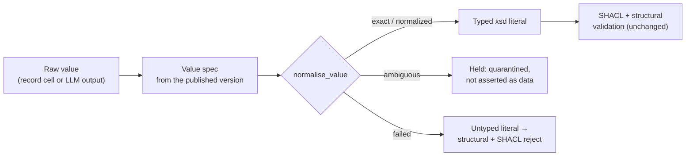

# Attribute value normalisation

LLM extraction and structured mappings hand the pipeline *raw text*: `97.0%`, `98.2 percentg`,
`Yes.`, `1,250.50`. SHACL and the structural check are strict - a value must be a literal of the
attribute's datatype - so a perfectly good `97.0%` for a decimal attribute used to be rejected as a
datatype violation. The normalisation layer closes that gap **without weakening either check**: it
types a value only when the conversion is unambiguous, records exactly what it did, and leaves
everything else to be rejected or quarantined.



The code is `backend/app/modules/kg/normalization.py`. It is pure (no I/O) and is called from
`assess_attribute_structure`, the single place every attribute fact passes through, so **structured
mappings and PDF extraction use exactly the same logic**.

## What decides the conversion

1. **The datatype** is read from the attribute's definition in the **selected, immutable published
   ontology version** of the build (`OntologyView.value_spec`). It never comes from the value.
2. **The unit** is also read from that definition. An attribute is *percentage-valued* when its
   label, local name, alias or description names a percentage: the words *percent*, *percentage*,
   *pct* (also in `camelCase` / `snake_case` names, e.g. `onTimePct`) or the `%` sign. Nothing else is
   assumed: *percentile*, *rate*, *capacity* or *unit cost* are plain numbers.
3. **The scale** of a percentage attribute is **0-100**. A definition that documents a different scale
   (a fraction, "between 0 and 1", a proportion) without also stating 0-100 is a conflict: percent
   values for it are held as ambiguous rather than rescaled.

## Rules

A value that is already a valid literal of the datatype is never touched: its canonical form is exactly
what the strict parser always produced (`420.00` stays `420.00`), so existing deterministic CSV values do
not change. Otherwise, by datatype:

| Datatype | Normalised (status `normalized`) | Not converted |
|---|---|---|
| decimal, float, double | `97.0%`, `97.0 %`, `97 percent`, `97 pct`, `97 per cent`, `98.2 percentg` (a one-edit misspelling of *percent* / *percentage*) → `97.0`, `97`, `98.2` **on a percentage attribute only**, on the 0-100 scale, the unit removed and the number kept as written. Thousands separators of exactly three digits: `1,250.50` → `1250.50`. | `97.0%` on an attribute that is not defined as a percentage; any other unit (`5 kg`, `12.50 USD`, `$12.50`, `3‰`); a decimal comma (`12,5`, `97,5%`); a leading zero group (`0,234`). All **ambiguous**. |
| integer, int, long | As above, plus an integral decimal written with a fraction: `42.0` → `42`, `97.0%` → `97` (percentage attribute). | `42.5`, `97.5%`: values are **never rounded** (failed). |
| boolean | `true/false`, `yes/no`, `1/0` in any case, with surrounding quotes or a closing `.`, `!`, `;`. | anything else (failed). |
| date | `2026-07-14`; `2026/07/14` and `2026.7.4` (year first); `2026-07-14T00:00:00` (a midnight time only); `25/07/2026` (day/month/year when only one reading is possible, or both parts are equal). | `04/07/2026` (day/month or month/day: **ambiguous**); a date-time with a time of day, or an impossible date (failed). |
| string, anyURI, dateTime, time, gYear | Never converted: the strict parser alone decides. A string keeps its `%` and every other symbol. | |

Qualifiers are not units. `approx. 1000`, `~97%`, `97.0% on time`, `1.2.3`, `ninety` and `n/a` are not
plain numbers and **fail** with the same datatype message as before. Only a unit *after* the number
(or a currency symbol before it) is considered; a unit the ontology does not define is never stripped.

Percent values are not range-checked here: `120%` is a valid number on the 0-100 scale. Limits are the job
of authored SHACL shapes (`sh:minInclusive` / `sh:maxInclusive`), which still run on the typed literal.

## Outcomes and validation

| Status | Meaning | Fact status | SHACL |
|---|---|---|---|
| `exact` | already a valid literal, unchanged | decided by the usual checks | judged as before |
| `normalized` | converted by a documented rule | decided by the usual checks | judged on the **typed** literal (`"97.0"^^xsd:decimal`) |
| `ambiguous` | more than one reading, or an undefined unit | **quarantined** (structural check `literal_ambiguous`) | not asserted: nobody could type the value |
| `failed` | not a literal of the datatype | **rejected** (structural check `literal_datatype`) | the raw text stays an untyped literal, so SHACL reports the datatype violation |

Accepted values are written to every graph target as typed literals and survive exactly as normalised
(`"97.0"^^xsd:decimal`; some stores, such as Oxigraph, canonicalise the lexical form of a decimal to
`97` - the value and datatype are unchanged).

**Evidence.** The evidence check still requires the quote to contain the value as the source wrote it.
For a numeric value that was normalised it also accepts a quote that states *the same number*
(`94.50` vs "94.5%"), compared by value on whole number tokens: the `97` of a normalised `97 percent` is
**not** found in `97.5%`, `97,5%`, `1997` or `S-97`.

**Conflicts.** Single-valued attributes compare numerically, so `97` from a PDF and `97.0` from a CSV agree;
`89.0` against `88.0` is still a conflict and the later fact is quarantined.

## Audit record

Every attribute fact stores, in `kg_candidate_facts.value_normalization`, how its value was typed; it is
returned as `value_normalization` by `GET /api/kg/facts/{id}` (and `normalization_status` in the fact
lists) and shown in **Knowledge Graph Studio → Fact Validation** under *Value normalisation*:

```json
{
  "status": "normalized",
  "raw_value": "98.2 percentg",
  "normalized_value": "98.2",
  "datatype": "decimal",
  "datatype_iri": "http://www.w3.org/2001/XMLSchema#decimal",
  "rule": "percentage-0-100",
  "unit": "percent",
  "scale": "0-100",
  "message": "'98.2 percentg' is a percentage and 'on-time delivery percentage' is defined as one: ..."
}
```

Together with the existing evidence (`sources`: the source record, or the located quote and the original
LLM quote), the fact's `value` / `datatype`, and the check and SHACL results, this is the full trail from
raw text to graph. Builds log the number of values per status and rule, and the evaluation reports
*Attribute values normalised* and *Ambiguous attribute values*.

## Historical builds

Value normalisation applies to **new builds only**. Migration `0011` adds the audit column as `NULL`;
no existing row, status, value, stored evaluation or graph is rewritten or re-judged. `NULL` means "built
before value normalisation existed" and the UI says so.

## Extending

Add a datatype or rule inside `normalize_value` and a test beside `tests/test_kg_value_normalization.py`.
A new unit (for example a currency) belongs in `value_spec_for`, derived from the attribute's definition,
with a rule that converts only when the definition and the value agree.

One correction rode along: thousands grouping no longer accepts a leading zero group, so `0,234` is no
longer silently read as `234`; it is now an ambiguous decimal comma.
